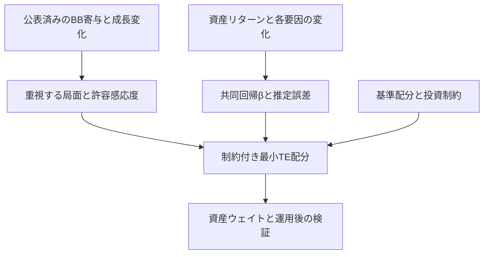

# 学術文献調査と配分戦略提案

**User:** Anonymous  
**Created:** 11/5/2026 22:14:46  
**Updated:** 11/6/2026 0:21:05  
**Exported:** 11/6/2026 7:43:30  
**Link:** [https://chatgpt.com/c/6aec813e-6838-83ee-81c2-266bcd61b0c4](https://chatgpt.com/c/6aec813e-6838-83ee-81c2-266bcd61b0c4)  

## Prompt:
2026/11/5 22:15:07

Bernake-Blanchard modelにてインフレ要因を分解し、各インフレ要因ごとにAQRのインフレ感応度分析を実施した。感応度の分析には予測値がなかったため、サプライズ要素は抜きでインフレおよび成長率の変化への分析とした。インフレ要因分析と各インフレ要因ごとの感応度を活用して投資対象資産をローテーションさせるような戦略を構築したい。支配的なインフレ要因に応じてインフレ感応度を考慮したアロケーションを提案できるフレームワークを学術的な文献を調査し提案してください。将来のインフレ要因の予測やリターンの予測をするような手法ではなく、あるインフレ要因の変化と成長変化が起こる局面に対して合理的なアロケーションを組む手法を構築したいと考えています。

[Attachment: AQR Alternative Thinking Q3 2026 - Inflation Redux(3).pdf]

[Attachment: wp24e01.pdf]

## Response:
2026/11/5 22:15:18 · gpt-6-pro

添付の2本を確認し、予測を使わずに「インフレ要因の変化と成長変化に対するポートフォリオの感応度」を設計する枠組みを調べます。支配的な要因の判定と、各資産への配分をつなぐ方法を中心に、学術文献と実装上の選択肢を整理します。PDF確認にはPDFスキルを使います。

AQRの添付資料にも、予測値を使わず「インフレ構成要素の変化」と「成長率の変化」で感応度を測る分析があります。一方、同資料の配分例は期待リターンを使っているため、今回の目的には、配分の目的を「期待収益の最大化」から「指定した局面での損失・感応度の管理」へ置き換えるのが適しています。また、インフレへの寄与が大きいことと、その寄与が拡大していることは分けて扱う必要があります。

文献上の整理では、BBの寄与分解はインフレが伝わる「経路」を示しており、需要ショックと供給ショックを完全に識別するものではありません。したがって、「エネルギー寄与の拡大＋成長減速」のように状態を記述し、その局面への耐性を設計するのが妥当です。配分には、支配要因への耐性を改善しつつ、要因が反転した場合の劣後も抑える方法が最も合いそうです。

提案の中心は、マクロ感応度を直接目標にする研究と、推定誤差を考慮した配分手法の組み合わせです。実装上は、既存の偏相関図を活かし、配分計算用に「全インフレ要因＋成長」の共同回帰βを追加するのが重要です。検証では、基準配分に加えて固定的なインフレ耐性配分とも比較し、BBに応じてローテーションすることの追加価値を確かめる設計にします。

> **プロジェクトファイルを検索する**
>
>
> **Reviewing quant framework evidence**
>
> Reviewing quant framework evidence
>
> **量化フレームワークの証拠を確認した**
>
> 
>
> **PDFテキスト抽出と内容確認**
>
>
> **プロジェクトファイルを検索した**
>
> 
>
> **Saving source results**
>
> Saving source results
>
> **Selecting core sources**
>
> Selecting core sources
>
> **保存用ソース結果を選定**
>
> 
>
> **6件のウェブサイトを検索しました**
>
> 
>
> **PDFテキストの追加部分を確認**
>
>
> **PDFテキストを抽出し追加内容を確認**
>
> 
>
> **28件のウェブサイトを検索しました**
>
> 
>
> **PDFテキストの指定箇所を抽出**
>
>
> **PDFテキストの指定箇所を抽出した**
>
> 
>
> **Rendering PDF pages**
>
> Rendering PDF pages
>
> **PDFページをレンダリングした**
>
> 
>
> **14件のウェブサイトを検索しました**
>
> 
>
> **インフレ資料の分析情報抽出**
>
>
> **抽出したインフレ資料の分析情報**
>
> 
>
> **Framing macro sensitivity controls**
>
> Framing macro sensitivity controls
>
> **整理したマクロ感応度の制御方針**
>
> 
>
> **Defining return aggregation**
>
> Defining return aggregation
>
> **定義したリターン集計**
>
> 
>
> **Building aggregated factor groups**
>
> Building aggregated factor groups
>
> **HACとブートストラップを整理します**
>
> HACとブートストラップを整理します
>
> **集約因子群を構築しHACとブートストラップを整理しました**
>
> 
>
> **Defining reduction targets**
>
> Defining reduction targets
>
> **Checking constraint feasibility**
>
> Checking constraint feasibility
>
> **削減目標を定義し制約の実現可能性を確認した**
>
> 
>
> **Assessing equity beta controls**
>
> Assessing equity beta controls
>
> **Defining exposure scaling**
>
> Defining exposure scaling
>
> **評価した株式ベータ管理とエクスポージャー調整定義**
>
> 
>
> **Checking factual claims**
>
> Checking factual claims
>
> **Adding statistical sources**
>
> Adding statistical sources
>
> **Refining optimization formulation**
>
> Refining optimization formulation
>
> **確認し統計資料を加えて最適化定式化を改良**
>
> 
>
> **Checking source details**
>
> Checking source details
>
> **確認した source details**
>
> 
>
> **Detailing the framework**
>
> Detailing the framework
>
> **Building scenario table**
>
> Building scenario table
>
> **整理したフレームワークとシナリオ表を作成**
>
> 
>
> **Reviewing scenario matrix**
>
> Reviewing scenario matrix
>
> **Refining scenario matrix**
>
> Refining scenario matrix
>
> **Assessing long-only hedge limits**
>
> Assessing long-only hedge limits
>
> **評価しロングオンリーのヘッジ制約付きシナリオマトリクスを精緻化**
>
> 
>
> **Clarifying exposure metric**
>
> Clarifying exposure metric
>
> **因果解釈を明確化します**
>
> 因果解釈を明確化します
>
> **露出指標と因果解釈を明確化しました**
>
> 
>
> **Defining threshold rules**
>
> Defining threshold rules
>
> **Refining scenario rules**
>
> Refining scenario rules
>
> **Including full-risk constraints**
>
> Including full-risk constraints
>
> **定義しシナリオと全面的リスク制約を精緻化した**
>
> 
>
> **Refining covariance choice**
>
> Refining covariance choice
>
> **精緻化した共分散の選択**
>
> 
>
> **12件のウェブサイトを検索しました**
>
> 
>
> **Checking arithmetic example**
>
> Checking arithmetic example
>
> **詳細な構成と引用を整理しています。**
>
> 詳細な構成と引用を整理しています。
>
> **確認した算術例と詳細構成・引用整理**
>
> 
>
> **Refining section distinctions**
>
> Refining section distinctions
>
> **Structuring Section 4 workflow**
>
> Structuring Section 4 workflow
>
> **エネルギー・賃金別のβ差を追記します**
>
> エネルギー・賃金別のβ差を追記します
>
> **整理したセクション構成と第4節のワークフローを更新しエネルギー・賃金別β差を追記**
>
> 
>
> **Simplifying exposure-constrained optimization**
>
> Simplifying exposure-constrained optimization
>
> **Refining soft exposure constraints**
>
> Refining soft exposure constraints
>
> **Defining plausible joint scenarios**
>
> Defining plausible joint scenarios
>
> **簡略化し軟性制約と現実的な同時シナリオを定義した**
>
> 
>
> **Preparing scenario tables**
>
> Preparing scenario tables
>
> **Organizing validation checks**
>
> Organizing validation checks
>
> **Comparing strategy variants**
>
> Comparing strategy variants
>
> **準備し検証チェックを整理して戦略案を比較**
>
> 
>
> **Structuring monthly report fields**
>
> Structuring monthly report fields
>
> **Mapping report citations**
>
> Mapping report citations
>
> **構造化し月次報告項目と引用を整理**
>
> 
>
> **Checking portfolio beta assumptions**
>
> Checking portfolio beta assumptions
>
> **インフレ要因の符号表現を整理しています**
>
> インフレ要因の符号表現を整理しています
>
> **ポートフォリオベータとインフレ要因の符号表現を確認した**
>
> 
>
> 10m 37s考えました

**今回の目的には、「BB要因別のマクロ感応度を目標として設定し、複数の経済局面への耐性を制約にして、基準配分からの変更を最小化するフレームワーク」が最も適しています。**

具体的には、次の役割分担にします。

- **BBによるインフレ分解**：現在、どの経路からインフレ圧力が生じているかを把握する。
- **AQR型の感応度分析**：各資産が、各インフレ要因の変化と成長率の変化に、どのように関連してきたかを測る。
- **ポートフォリオ構築**：重視する局面に対する感応度や損失許容幅を決め、それを満たす資産配分を求める。

例えば、「商品コスト要因の寄与が大きく、成長が減速している」という観測結果に対し、**商品コスト要因の増加と成長減速が重なる局面で、ポートフォリオの脆弱性を一定程度減らす**という目標を置きます。将来の要因変化や期待リターンを数値予測する必要はありません。

ただし、現在の支配要因に応じて配分を変える以上、**どのリスクへの備えを優先するかという投資方針は必要**です。また、過去に測った感応度が保有期間にもある程度使えるという仮定は残ります。以下では、この点を明示したうえで、文献の根拠と具体的な設計を整理します。

---

## 1．現在の分析は、AQRの枠組みと整合している

まず、サーベイ予測がないためにサプライズを除いたことは、今回の目的に対する致命的な問題ではありません。

添付のAQR資料 :codex-file-citation{path="sandbox:/workspace/scratch/aba268704ff8/upload/AQR Alternative Thinking Q3 2026 - Inflation Redux(3).pdf" purpose="source"} では、主分析で次の2つを組み合わせています。

1. 前年比インフレ率の12か月変化。
2. 実現した前年比インフレ率と、1年前の予測値との差。

一方、**p.8のExhibit 6では、コア・食料・エネルギーについて、前年比インフレ率の12か月変化だけを使い、GDP成長率の変化を制御した同時点偏相関を計算しています。**

したがって、ご自身の分析は、

> **AQRの構成要素別感応度分析を、CPIの品目分類からBBモデルの要因寄与へ拡張したもの**

と位置づけられます。

ただし、解釈は「観測されたマクロ変化への感応度」です。市場の事前情報から予想できなかった部分を厳密に抽出したショック感応度とは区別します。また、同時点の感応度があることだけでは、翌期リターンを予測できることにはなりません。

もう一つ、AQRの配分例との違いがあります。**同資料pp.11-13の最適化は、将来を見据えた期待リターンを使って期待複利リターンを最大化しています。** 今回は、その目的関数を「感応度の管理」「基準配分からの乖離の抑制」「シナリオへの耐性」に変更するのが適切です。

---

## 2．学術文献から、何を組み合わせるべきか

今回に最も近いのは、単独のレジーム予測モデルではなく、以下の研究を組み合わせる方法です。**BB寄与によるローテーションそのものが、これらの論文で検証済みという意味ではありません。文献で確立された考え方を、今回の分析に接続する設計提案です。**

| 文献 | 研究の主な内容 | 今回への適用 |
|---|---|---|
| **Esakia & Goltz（2023）** “Targeting Macroeconomic Exposures in Equity Portfolios: A Firm-Level Measurement Approach for Out-of-Sample Robustness,” *Financial Analysts Journal*, 79(1), 37-57 | 個別株のマクロ感応度を推定し、望ましい感応度を持つポートフォリオを構築。運用後の感応度の安定性を評価する | **最も直接的な基礎。リターン順位ではなく、ポートフォリオのマクロ感応度を運用目標にする。** ただし原論文は市場価格由来のマクロ変数を使うため、BBの実現変化への適用は拡張となる。([rpc.cfainstitute.org](https://rpc.cfainstitute.org/research/financial-analysts-journal/2022/targeting-macroeconomic-exposures-in-equity-portfolios?utm_source=chatgpt.com)) |
| **Cieslak & Pflueger（2023）** “Inflation and Asset Returns,” *Annual Review of Financial Economics*, 15, 433-448 | インフレと資産価格の関係を、需要・供給要因や景気との関係から整理 | **インフレ要因と成長変化を組み合わせる経済的根拠。** インフレ上昇という一つのラベルだけで株式・債券の役割を決めない。([bfi.uchicago.edu](https://bfi.uchicago.edu/wp-content/uploads/2023/03/BFI_WP_2023-34.pdf?utm_source=chatgpt.com)) |
| **Roncalli & Weisang（2016）** “Risk Parity Portfolios with Risk Factors,” *Quantitative Finance*, 16(3), 377-388 | 資産別ではなく、基礎となる因子別のリスク寄与を管理する | BB要因・成長・その他のリスクへの集中を測る。ただし、**リスク寄与の均等化だけでは、インフレ上昇時に損失を抑える方向の配分は決まらない。**([mpra.ub.uni-muenchen.de](https://mpra.ub.uni-muenchen.de/44017/1/MPRA_paper_44017.pdf?utm_source=chatgpt.com)) |
| **Goldfarb & Iyengar（2003）** “Robust Portfolio Selection Problems,” *Mathematics of Operations Research*, 28(1), 1-38 | 推定パラメータに不確実性集合を置き、推定誤差に頑健な配分を構築する | BB要因へのβを点推定だけで信じず、**誤差を考慮しても目標感応度を満たす配分**を求める。原論文の期待収益を含む最適化全体ではなく、不確実性の扱いを採用する。([pubsonline.informs.org](https://pubsonline.informs.org/doi/abs/10.1287/moor.28.1.1.14260?utm_source=chatgpt.com)) |
| **Young（1998）** “A Minimax Portfolio Selection Rule with Linear Programming Solution,” *Management Science*, 44(5), 673-683 | 過去の観測期間における最大損失を抑える配分を構築する | シナリオごとの発生確率を置かずに、悪い局面への耐性を設計する参考。原論文には収益水準の制約があるため、今回は基準配分・TE・政策上の制約に置き換える。([pubsonline.informs.org](https://pubsonline.informs.org/doi/abs/10.1287/mnsc.44.5.673?utm_source=chatgpt.com)) |
| **Bouyé & Teiletche（2025）** “Regime-Based Strategic Asset Allocation,” *Financial Analysts Journal*, 81(4), 84-102 | レジーム別ポートフォリオ、そのリスク構造、長期的なレジーム確率から戦略配分を構築する | **局面ごとの配分を事前に設計する**考え方が参考になる。ただし、現在のBB寄与率を将来レジーム確率として使うことは、この研究から正当化されない。([rpc.cfainstitute.org](https://rpc.cfainstitute.org/research/financial-analysts-journal/2025/regime-based-strategic-asset-allocation?utm_source=chatgpt.com)) |

さらに、Campbell, Pflueger & Viceira（2020）の *Macroeconomic Drivers of Bond and Equity Risks* は、インフレと実体経済の共変動が変わることで、名目債券の株式に対するヘッジ特性が変わることを示しています。これは、**インフレ要因だけでなく成長を同時に扱う必要性**を補強します。([hbs.edu](https://www.hbs.edu/ris/Publication%20Files/14-031_7e2f7895-a381-4407-9122-e5836ea24d79.pdf?utm_source=chatgpt.com))

今回の中心に据えるのは、**Esakia-Goltzの感応度ターゲティングに、Goldfarb-Iyengarの推定誤差への対応と、シナリオ制約を加える方法**です。因子リスク配分やレジーム別配分は、その補助として使います。

---

## 3．設計前に分けるべき、3つの概念

### 3.1 BBの「寄与経路」と構造的な需要・供給ショック

添付の日銀論文 :codex-file-citation{path="sandbox:/workspace/scratch/aba268704ff8/upload/wp24e01.pdf" purpose="source"} は、結論の本文p.16で、モデルが労働市場・商品市場における独立した需要・供給ショックを明示的に識別していないと述べています。

したがって、レジーム名は、最初は以下のように付けるのが堅実です。

| BBから得られるもの | 運用上の呼び方 | 追加の識別なしには断定できないこと |
|---|---|---|
| エネルギー・食料価格の寄与 | 商品価格・輸入コスト経路 | 純粋な供給ショックである |
| 供給制約の寄与 | 供給制約経路 | 他の需要変化から独立している |
| 労働需給の寄与 | 労働需給・賃金経路 | 純粋な需要拡大である |
| 初期条件・方程式残差など | 継承された圧力・その他 | 特定の投資テーマに直結する |

特に、「賃金に由来するインフレなら健全な需要拡大」とは限りません。Cieslak-Pfluegerの整理でも、賃金交渉力の上昇はコストプッシュを生む例に含まれています。**BBの経路と、観測された成長変化を併記する**方が適切です。([bfi.uchicago.edu](https://bfi.uchicago.edu/wp-content/uploads/2023/03/BFI_WP_2023-34.pdf?utm_source=chatgpt.com))

また、BBの動学的な寄与分解には、期待や賃金を通じた二次波及が含まれます。エネルギー要因の寄与に含まれる賃金経由の波及を、別途「賃金要因」として再加算しないよう、寄与の定義を統一します。

### 3.2 インフレへの寄与が大きいことと、寄与が拡大していること

BBの分解を、概念的に次のように書きます。

$$
\pi_t=c_{0,t}+\sum_{k=1}^{K}c_{k,t}+u_t
$$

ここで、$c_{k,t}$ は要因 $k$ の寄与、$c_{0,t}$ は初期条件等、$u_t$ は未説明部分です。

配分に使う際には、少なくとも次の2つを別に保持します。

$$
\underbrace{c_{k,t}}_{\text{インフレ水準への寄与}}
,\qquad
\underbrace{x_{k,t}=\mathcal D c_{k,t}}_{\text{感応度分析に使った寄与の変化}}
$$

例えば、食料要因の寄与が **2.0％ポイントから1.0％ポイントへ低下**した場合、食料は依然として大きな押し上げ要因でも、寄与の変化はマイナスです。

このとき、「食料要因が最大なので、その増加に対して正のβを持つ資産を買う」という判断には、寄与が再び拡大するという方向性の判断が入り得ます。

運用画面では、以下を分けて表示します。

| 項目 | 答える問い |
|---|---|
| 寄与の水準 | 現在のインフレを何が押し上げ・押し下げているか |
| 寄与の変化 | どの圧力が強まり、どの圧力が弱まっているか |
| 基準ポートフォリオのβ | その要因の変化に、現在の資産配分がどれだけ反応するか |
| シナリオ別の感応度 | その要因と成長が同時に変化すると、どこが脆弱か |

「支配度」の指標としては、例えば、

$$
d^{\mathrm{level}}_{k,t}
=
\frac{|\bar c_{k,t}|}
{\sum_j|\bar c_{j,t}|},
\qquad
d^{\mathrm{change}}_{k,t}
=
\frac{|x_{k,t}|}
{\sum_j|x_{j,t}|}
$$

を使い、符号は別に記録できます。ここで $\bar c$ は一定期間の平均寄与です。正のインフレ圧力に絞るなら、正の寄与だけで構成比を計算します。

**この構成比は将来シナリオの確率ではありません。** また、全要因の変化が小さい局面でも最大要因は必ず生まれるため、構成比に加えて絶対的な圧力の大きさも確認します。

### 3.3 正のインフレβと、高い期待リターン

インフレ上昇時に価値を保つ資産は、ヘッジとして有用でも、それだけで平均リターンが高いとは言えません。

Boons et al.（2020）, *Time-Varying Inflation Risk and Stock Returns*, *Journal of Financial Economics*, 136(2), 444-470は、インフレが悪い実体経済状態と結びつく場合、高いインフレβを持つ株式がヘッジとして評価され、低いリスクプレミアムを伴い得ると説明しています。([newyorkfed.org](https://www.newyorkfed.org/medialibrary/media/research/economists/duarte/inflation_NRC_JFE2019.pdf?utm_source=chatgpt.com))

したがって、本戦略の第一の評価目標は、**選んだ局面への耐性を、許容できるコストと他局面での代償で実現できたか**に置きます。

---

## 4．配分計算には、偏相関に加えて「共同回帰β」を用意する

ここは、既存分析からの最も重要な追加部分です。

### 4.1 偏相関は比較に使い、βは配分の集計に使う

共通の説明変数・単位で推定したβなら、ポートフォリオの感応度を、

$$
\beta_{P,k}=\sum_i w_i\beta_{i,k}
$$

と集計できます。

一方、偏相関については、一般に、

$$
\rho_{P,k}\neq\sum_i w_i\rho_{i,k}
$$

です。偏相関はリターンの残差ボラティリティなどで標準化されているためです。

OLSの場合、両者の関係は、

$$
\beta_{i,k}
=
\rho(r_i,x_k\mid C)
\frac{\sigma(r_i\mid C)}
{\sigma(x_k\mid C)}
$$

です。$C$ は制御変数であり、$\sigma(\cdot\mid C)$ はそれらを除いた残差の標準偏差です。

したがって、**既存の偏相関図は残し、配分用にはβとその推定誤差を追加する**のがよいと思います。

### 4.2 要因ごとの2変数回帰を、そのまま足し合わせない

もし現在の分析が、各要因について個別に、

$$
r_i=\alpha_i+\beta_{i,k}^{(2)}x_k+\gamma_{i,k}x_g+\epsilon_i
$$

を推定しているなら、各 $\beta_{i,k}^{(2)}$ は他のインフレ要因との相関も含みます。その係数を横に並べて混合シナリオを計算すると、影響を重複して数える可能性があります。

配分用には、追加で、

$$
r_{i,t}^{(H)}
=
\alpha_i
+
\sum_{k=1}^{K}\beta_{i,k}x_{k,t}^{(H)}
+
\gamma_i x_{g,t}^{(H)}
+
\epsilon_{i,t}
$$

という**全要因と成長を同時に入れた回帰**を推奨します。

ここでの $r^{(H)}$ と $x^{(H)}$ は、対応する同じ期間のリターンとマクロ変化です。翌期リターンを被説明変数にする予測回帰ではありません。

実装上は、以下を守ります。

- 要因同士の相関が強い場合は、経済的に意味のある集約や係数の縮小を使う。
- 合計インフレ率と、その全構成寄与を同時に入れて完全共線性を作らない。
- 回帰の切片 $\alpha_i$ を、配分の期待収益として使わない。
- 成長を制御したβを、成長への波及まで含む因果的な総効果と解釈しない。

Esakia-Goltzも、マクロ感応度の測定誤差への対応を重視しています。ただし、同論文の市場価格由来データによる推定結果を、そのまま低頻度のBB寄与へ移せるわけではありません。([doi.org](https://doi.org/10.1080/0015198X.2022.2150500?utm_source=chatgpt.com))

### 4.3 BBとAQRの期間・単位をそろえる

日銀のBB日本版は、季節調整した前期比年率のインフレを対象としています。一方、AQR Exhibit 6は前年比インフレ率の12か月変化です。

BB寄与が四半期年率の**対数変化**なら、前年比に対応する寄与は、

$$
c_{k,t}^{YoY}
=
\frac14\sum_{j=0}^{3}c_{k,t-j}^{q,ann}
$$

で表せます。その後、

$$
x_{k,t}=c_{k,t}^{YoY}-c_{k,t-4}^{YoY}
$$

とすればAQR型の変化に対応します。通常の百分率を使っている場合、単純平均は近似となるため、既存実装の定義に合わせます。

**既存の感応度がどの変換に対して推定されたかを、そのまま配分側にも引き継ぐことが重要です。**

---

## 5．提案するフレームワーク

### 全体構造



### 5.1 各要因について、成長と組み合わせた4局面を用意する

要因 $k$ ごとに、最低限、次の4つを評価します。

| 要因寄与の変化 | 成長率の変化 | 状態の記述 | 配分上の着眼点 |
|---|---|---|---|
| 増加 | 加速 | 当該要因の圧力拡大と成長加速 | 当該要因への脆弱性を抑えながら、成長への参加をどこまで維持するか |
| 増加 | 減速 | 当該要因の圧力拡大と成長減速 | 要因増加と成長減速の両方で損失が出る集中を減らす |
| 減少 | 加速 | 当該要因の圧力緩和と成長加速 | インフレ対応資産への集中による劣後を抑える |
| 減少 | 減速 | 当該要因の圧力緩和と成長減速 | 圧力緩和だけで安心せず、成長減速への感応度を管理する |

ここで「成長加速」は成長率の変化がプラスという意味です。成長率そのものがプラスとは限りません。同様に、要因寄与が減少していても、その要因がインフレを押し上げていることはあります。

エネルギー要因と労働需給要因では、同じ「寄与増加＋成長減速」でも各資産のβが異なります。**この違いによって、必要な配分変更が変わる**構造にします。

最初から局面ごとに別々の回帰を大量に推定する必要はありません。共通のβ行列を使い、シナリオ側を変えるだけで始められます。

### 5.2 最小構成は「許容するβの範囲」を直接指定する

資産数を $N$、BB要因と成長への感応度行列を、

$$
B_t\in\mathbb R^{N\times(K+1)}
$$

と置くと、配分 $w$ の感応度は、

$$
b_t(w)=B_t^\top w
$$

です。

例えば、基準配分のエネルギー要因への感応度が大きくマイナスなら、

> エネルギー要因への感応度をゼロに近づける。ただし成長への感応度は基準配分の一定範囲内に維持する。

という目標を置きます。

最適化は、次のように書けます。

$$
\min_{w\in\mathcal W}
\left[
\frac12(w-w^b)^\top\widehat\Sigma_t(w-w^b)
+
\lambda_{\mathrm{TO}}
\sum_i \kappa_i|w_i-w_{i,t-1}|
\right]
$$

制約として、

$$
|b_{k,t}(w)|\le u_{k,t},
$$

$$
\underline b_{g,t}
\le b_{g,t}(w)
\le \overline b_{g,t}
$$

などを課します。

- $w^b$：基準配分。
- $\widehat\Sigma_t$：資産リターンの共分散行列。
- 第1項：基準配分からのトラッキングエラーの二乗に対応。
- 第2項：売買コスト・回転率の抑制。
- $u_{k,t}$：当該要因に許容する感応度の大きさ。
- $\mathcal W$：ロングオンリー、資産上限、株式・債券の政策配分範囲など。

**BBの支配度は、$u_{k,t}$ をどこまで厳しくするかに使います。**

この方式は、要因の増加・減少のどちらかを当てにいかず、現在重視する要因への依存を小さくするという意味で、最も明確に「予測を使わない」設計です。

### 5.3 要因と成長の組み合わせを重視する場合は、シナリオ制約へ拡張する

シナリオ $s$ を、各要因と成長の変化を並べたベクトルとします。

例えば、

$$
s=
\begin{pmatrix}
\text{エネルギー寄与変化 }+1\sigma\\
\text{その他の要因 }0\\
\text{成長率変化 }-1\sigma
\end{pmatrix}
$$

です。

このシナリオに対する感応度を、

$$
m_s(w)=w^\top B_t s
$$

で比較します。

ここでの $m_s(w)$ は、**指定した変化に対応するマクロ感応度の損益換算**です。切片や残差を含まないため、ポートフォリオの総リターン予測ではありません。

先ほどの最小TE問題に、次の制約を追加します。

#### 重視する局面で、基準配分より一定幅改善する

$$
m_s(w)-m_s(w^b)\ge h_{s,t}
\qquad
(s\in\mathcal S_{\mathrm{priority},t})
$$

#### その他の局面で、劣後を一定幅までに抑える

$$
m_s(w)-m_s(w^b)\ge-d_s
\qquad
(s\in\mathcal S_{\mathrm{other}})
$$

例えば、重点局面で基準配分のマクロ感応度部分が $-8\%$ なら、その損失感応度を一定割合改善するよう $h_{s,t}$ を定めます。

ここで配分変更の必要性を決めるのは、**BBの支配度と基準配分の脆弱性の両方**です。ある要因がインフレの主因でも、基準配分がその要因にほとんど脆弱でなければ、大きな変更は不要です。

シナリオ確率を推定せず、「この局面にはこれだけ備える」「反転時の代償はここまで」という運用方針で配分を決められます。条件付きの損益換算も使いたくない場合は、前項のβ制約だけで実装できます。

### 5.4 推定誤差を配分へ反映する

BB要因も資産βも推定値なので、点推定上だけで優れた資産に集中しないことが必要です。

拡張版では、β行列の不確実性集合 $\mathcal B_t$ を用意し、

$$
\min_{B\in\mathcal B_t}
(w-w^b)^\top Bs
\ge h_{s,t}
$$

という制約を使えます。

これは、**推定誤差を考慮しても、重点シナリオで一定の改善が残る配分を選ぶ**という意味です。Goldfarb-Iyengarの考え方を、今回の感応度制約へ適用したものです。([pubsonline.informs.org](https://pubsonline.informs.org/doi/abs/10.1287/moor.28.1.1.14260?utm_source=chatgpt.com))

最初の実装では、係数の縮小、複数推定期間での安定性確認、ブロック・ブートストラップによる感応度の幅の表示から始めてもよいと思います。

---

## 6．数値例：どのような配分変更を目指すのか

以下は、**仕組みを説明するための仮の数値**です。実際の分析結果や予測値ではありません。

1標準偏差の要因変化に対する感応度が、次のように変わったとします。

| 感応度 | 基準配分 | 配分変更後 |
|---|---:|---:|
| エネルギー寄与変化へのβ | -3％ | -1％ |
| 成長率変化へのβ | ＋5％ | ＋5％ |

これは、成長への参加を維持しながら、エネルギー要因への負の感応度を弱めた配分です。

各局面へのマクロ感応度を計算すると、以下になります。

| シナリオ | 基準配分 | 配分変更後 | 基準配分との差 |
|---|---:|---:|---:|
| エネルギー寄与＋1σ、成長変化-1σ | -8％ | -6％ | ＋2％ |
| エネルギー寄与＋1σ、成長変化＋1σ | ＋2％ | ＋4％ | ＋2％ |
| エネルギー寄与-1σ、成長変化＋1σ | ＋8％ | ＋6％ | -2％ |
| エネルギー寄与-1σ、成長変化-1σ | -2％ | -4％ | -2％ |

この配分変更は、エネルギー寄与増加への耐性を高めます。同時に、寄与が減少したときに基準配分が享受するメリットの一部を手放します。

**この代償を明示して判断することが、本フレームワークの中心です。**

線形感応度を変えるだけでは、同じ因子の正反対の変化に対して、両方とも基準配分を厳密に上回ることはできません。重点シナリオの改善幅と反転時の劣後上限には、整合性が必要です。両立しない場合は、改善目標を緩めるか、投資可能資産を広げる必要があります。

---

## 7．「支配的なインフレ要因」に応じたローテーションをどう実装するか

### 推奨する主仕様

最初は、次の運用規則がよいと思います。

**① 支配的要因を判定する**

寄与の水準と変化を別々に確認し、単一要因への集中、複数要因の混合、圧力が弱い局面を識別します。

**② その要因に対する基準配分の脆弱性を測る**

要因の支配度が大きいだけで配分を変えず、当該要因と成長の組み合わせに対する基準配分の感応度を確認します。

**③ 必要な感応度改善幅を決める**

初期仕様では、支配的要因への過大な負の感応度をゼロへ近づけます。積極的に大きな正βへ振る設計は、別の運用方針として区別します。

**④ 最小TE・売買抑制の下で資産ウェイトを求める**

感応度が少し変わっただけで配分が全面的に入れ替わらないよう、売買抑制と資産上限を入れます。複数要因が拮抗する局面では、目標を連続的に変える方が扱いやすいです。

この設計なら、商品コスト経路が支配的なときにはそのβを改善する資産が選ばれ、労働需給経路が支配的になれば別の資産の組み合わせが選ばれます。**ローテーションは、目標とするマクロ感応度の変更の結果として生じます。**

### 個別資産の名称から、先に配分を決めない

「エネルギー主導なら資源株」「賃金主導なら銀行株」といった固定的な対応は、候補の探索には使えても、配分ルールの主軸にはしない方がよいです。

実際の選択は、ご自身が推定した、

$$
(\beta_{i,\mathrm{energy}},
\beta_{i,\mathrm{food}},
\beta_{i,\mathrm{labour}},
\ldots,\gamma_i)
$$

の組み合わせで決めます。例えば、当該インフレ要因に正βでも、成長減速に極端に弱い資産なら、両者が重なる局面のヘッジとしては不十分です。

AQRも、金や物価連動債には実質金利など別のリスクがあり、インフレに関係する資産であっても、特定局面で期待どおりに働くとは限らないことを説明しています。したがって、要因感応度に加え、総リスク・金利・為替・集中度も制約します〔添付AQR、pp.7、18〕。

### ロングオンリーでは、達成できる感応度に限界がある

ロングオンリーのポートフォリオ感応度は、投資可能資産の感応度の凸結合です。

例えば、全資産の労働需給要因βがマイナスなら、ウェイト調整だけでそのβをプラスにはできません。その場合の選択肢は、

- 負の感応度を可能な範囲で小さくする。
- 現金等を含めて曝露を薄める。
- 投資可能であれば、異なる感応度を持つ資産を追加する。

となります。目標を満たせない場合は、**達成できなかった感応度を表示する**設計が必要です。

---

## 8．因子リスクパリティは、補助として使う

期待リターンを使わない配分という点で、因子リスクパリティは有力です。ただし、今回の主目的には、感応度目標やシナリオ制約の方が直接的です。

理由は、リスクの大きさと望ましい方向が異なるためです。因子が無相関なら、同じ大きさの正βと負βは同じ分散寄与を持ちますが、インフレ上昇局面では意味が逆になります。

また、BB要因は相関し得るため、因子共分散を $\Omega$、ポートフォリオβを $b$ とすると、因子部分の分散は、

$$
b^\top\Omega b
$$

であり、単純に各因子の $\beta_k^2\sigma_k^2$ を足すだけでは足りません。

Roncalli-Weisangの枠組みは、こうした**基礎因子への集中を把握するために使い、方向を伴う耐性はシナリオ制約で管理する**のがよいと思います。([mpra.ub.uni-muenchen.de](https://mpra.ub.uni-muenchen.de/44017/1/MPRA_paper_44017.pdf?utm_source=chatgpt.com))

さらに、BB要因で説明されないリターン変動も残ります。配分最適化の共分散行列や総リスク上限には、その残差リスクも含めます。

---

## 9．検証で最も重要なのは、「BBで切り替える追加価値」があるか

この戦略を評価する際は、リターンやSharpeだけで結論を出さず、次の順番で確認することを勧めます。

### 9.1 比較対象を分ける

| 比較対象 | 確認すること |
|---|---|
| **基準配分** | 感応度を調整する価値があるか |
| **状態に依存しない固定のインフレ耐性配分** | 常時備えるだけでも十分ではないか |
| **BB状態に応じた提案配分** | 要因に応じてローテーションする追加価値があるか |
| 必要なら単純な感応度上位配分 | 最適化・成長制御・反転制約が改善に寄与するか |

**固定的な耐性配分との比較が特に重要です。** 基準配分には勝っても、固定配分と同程度で売買だけ多いなら、BBによるローテーションを追加する根拠は弱くなります。

### 9.2 主要評価指標

最初に確認したいのは、以下です。

1. **運用後の感応度**  
   事前に狙ったβの変更が、アウト・オブ・サンプルでも実現したか。

2. **対象局面での実現損失**  
   各インフレ要因の変化と成長変化の組み合わせ別に、基準配分から損失が減ったか。

3. **反転局面・平時での代償**  
   劣後幅、TE、集中度、回転率、売買コストが許容範囲か。

4. **運用全体の成果**  
   実現リターン、ボラティリティ、最大ドローダウン、Sharpe等。

局面別評価を事後に行うこと自体は問題ありません。ただし、売買時点のウェイトは、その時点で利用できた情報だけから作る必要があります。

### 9.3 BBを使うために必要な検証上の注意

**公表日と改定履歴**

四半期末のマクロ値を、その四半期末に既知だったものとして扱わないようにします。BBの係数推定にも、その時点より後のデータを使わないことが必要です。改定前データを再現できない場合は、検証が疑似リアルタイムであることを明示します。

**寄与系列の定義**

歴史分解の初期条件や基準時点を途中で変えると、経済変化とは別の理由で寄与が変わることがあります。支配度の時系列を作る際には、分解の定義をそろえます。

**期間の重複**

AQR型の四半期ごとの12か月リターンは重複しています。通常の独立標本として標準誤差を計算せず、HACやブロック・ブートストラップなどで時系列依存に対応します。BB寄与自体の持続性も考慮します。

**二段階推定の誤差**

資産βだけでなく、その説明変数となるBB寄与も推定値です。可能であれば、BB推定から感応度推定までを含めて頑健性を確認します。

**感応度の期間と保有期間**

12か月変化へのβを、そのまま1か月先や3か月先のリターン係数として使わないようにします。月次で配分を更新することと、12か月のマクロ感応度を管理することは両立しますが、短期保有での効果は別途実現リターンで検証します。

**通貨と投資対象**

日本のBB要因を使う場合は、円建てで何を守るのかを固定します。外国資産のヘッジ有無は別資産として扱う方が明確です。株式内の配分なら、マクロ感応度の改善が単なる市場βの大幅削減になっていないかも確認します。

---

## 10．既存分析から追加するなら、この仕様を推奨する

最初の検証版は、次の範囲で十分に構築できます。

| 項目 | 推奨する初期仕様 |
|---|---|
| BB要因 | 既存の寄与系列を維持し、初期条件・残差を別表示 |
| 状態把握 | 寄与水準、寄与変化、成長率変化を別々に保持 |
| 既存の感応度分析 | 要因別偏相関を診断用として維持 |
| 追加推定 | BB全要因＋成長の共同回帰βと推定誤差 |
| 配分の主目標 | 支配的要因への過大な感応度を縮小 |
| 成長の扱い | 基準配分に対する許容帯を設定 |
| 最適化 | 最小TE＋売買抑制、期待リターン項なし |
| シナリオ | 主因の増加・減少と成長加速・減速の4局面 |
| 実行制約 | ロングオンリー、資産上限、政策配分範囲、総リスク上限 |
| 判断が弱い局面 | 配分変更幅を小さくし、基準配分へ近づける |
| 主な比較対象 | 基準配分と、固定的なインフレ耐性配分 |
| 成功判定 | 目標βの実現、対象局面での損失縮小、反転時の代償、コスト控除後の追加価値 |

この仕様で作る運用レポートは、各回について、

> 「どの要因が支配的か」「その寄与は増加中か減少中か」「基準配分のどの感応度が問題か」「配分変更で何をどれだけ改善したか」「反転時に何を手放したか」

を説明できる形にします。

なお、ここで管理するのは**インフレ要因の変化に伴う資産価格の感応度**です。物価水準の上昇から実質資産価値や負債価値を完全に守ることとは、目標が異なります。

研究上の最初の到達点は、**「BBで把握した経済状態に応じて、意図したマクロ感応度を実現でき、その変更が固定的な耐性配分よりも有効だったか」**を示すことです。この問いに絞れば、将来のインフレ要因や期待リターンの予測モデルを追加せずに、配分戦略として検証できます。

---

**Sources:**

- [Targeting Macroeconomic Exposures in Equity Portfolios](https://rpc.cfainstitute.org/research/financial-analysts-journal/2022/targeting-macroeconomic-exposures-in-equity-portfolios?utm_source=chatgpt.com)
- [https://bfi.uchicago.edu/wp-content/uploads/2023/03/BFI_WP_2023-34.pdf](https://bfi.uchicago.edu/wp-content/uploads/2023/03/BFI_WP_2023-34.pdf?utm_source=chatgpt.com)
- [https://mpra.ub.uni-muenchen.de/44017/1/MPRA_paper_44017.pdf](https://mpra.ub.uni-muenchen.de/44017/1/MPRA_paper_44017.pdf?utm_source=chatgpt.com)
- [Robust Portfolio Selection Problems](https://pubsonline.informs.org/doi/abs/10.1287/moor.28.1.1.14260?utm_source=chatgpt.com)
- [https://www.hbs.edu/ris/Publication%20Files/14-031_7e2f7895-a381-4407-9122-e5836ea24d79.pdf](https://www.hbs.edu/ris/Publication%20Files/14-031_7e2f7895-a381-4407-9122-e5836ea24d79.pdf?utm_source=chatgpt.com)
- [Time-Varying Inflation Risk and Stock Returns](https://www.newyorkfed.org/medialibrary/media/research/economists/duarte/inflation_NRC_JFE2019.pdf?utm_source=chatgpt.com)
- [Full article: Targeting Macroeconomic Exposures in Equity Portfolios: A Firm-Level Measurement Approach for Out-of-Sample Robustness](https://doi.org/10.1080/0015198X.2022.2150500?utm_source=chatgpt.com)

## Prompt:
2026/11/5 22:34:24

**Esakia & Goltz（2023）** の内容も要約してください。そのご提案フレームワークについてより詳細に説明をしてください

## Response:
2026/11/5 22:34:30 · gpt-6-pro

Esakia & Goltz（2023）の原論文を確認し、感応度の推定方法、ポートフォリオの構築方法、検証結果を要約します。そのうえで、論文から採用できる部分とBB要因への適用で追加設計が必要な部分を分け、提案フレームワークを数式と運用手順まで詳しく説明します。

原論文で重要なのは、マクロ感応度の推定値をそのまま信じず、「その感応度で選んだ銘柄が、次の保有期間にも意図した反応を示すか」を検証している点です。また、実現インフレや成長率を使った推定は、論文の検証では安定しにくいと報告されています。BBへの適用では、この点を踏まえ、配分戦略の成績と感応度自体の再現性を分けて評価する必要があります。

フレームワークの説明には、仮の4資産を使った数値例も加えます。成長への感応度を保ったまま、商品コスト要因と労働需給要因のどちらを重視するかによって資産比率がどう変わるかを計算しました。あわせて、BB状態から目標βを決める部分と、その目標を最小のアクティブリスクで実現する部分を分けて示します。

> **Awaiting the paper source**
>
> Awaiting the paper source
>
> **Preparing sourced framework**
>
> Preparing sourced framework
>
> **論文ソースを待ち出典付き枠組みを準備した**
>
> 
>
> **数値例と式を整えます**
>
> 数値例と式を整えます
>
> **数値例の前提と資産設定を整えます**
>
> 数値例の前提と資産設定を整えます
>
> **数値例の前提と式を整えました**
>
> 
>
> **39件のウェブサイトを検索しました**
>
> 
>
> **Inspecting Table 1 results**
>
> Inspecting Table 1 results
>
> **Checking source availability**
>
> Checking source availability
>
> **Computing example weights**
>
> Computing example weights
>
> **確認された表1結果と出典を基に例示重みを計算**
>
> 
>
> **1件のウェブサイトを検索しました**
>
> 
>
> **計算シナリオ別ポートフォリオ調整**
>
>
> **Checking example weights**
>
> Checking example weights
>
> **Specifying target adjustments**
>
> Specifying target adjustments
>
> **確認し目標調整を指定**
>
> 
>
> **Defining growth constraints**
>
> Defining growth constraints
>
> **Refining state-dominance metrics**
>
> Refining state-dominance metrics
>
> **Balancing factor pressure metrics**
>
> Balancing factor pressure metrics
>
> **定義し成長制約と状態優位性・要因圧力指標を調整**
>
> 
>
> **Checking beta comparability**
>
> Checking beta comparability
>
> **ベータの比較可能性を確認した**
>
> 
>
> **Checking horizon-date alignment**
>
> Checking horizon-date alignment
>
> **Choosing primary scenario design**
>
> Choosing primary scenario design
>
> **Refining robust scenario design**
>
> Refining robust scenario design
>
> **確認し、主要かつ堅牢なシナリオ設計を精緻化した**
>
> 
>
> **Defining bilateral risk bounds**
>
> Defining bilateral risk bounds
>
> **Structuring vintage-aware inputs**
>
> Structuring vintage-aware inputs
>
> **Specifying exposure regressions**
>
> Specifying exposure regressions
>
> **定義し構造化したヴィンテージ対応の双方向リスク回帰入力**
>
> 
>
> **Deriving total-beta mapping**
>
> Deriving total-beta mapping
>
> **Clarifying exposure normalization**
>
> Clarifying exposure normalization
>
> **導出した総ベータ対応関係とエクスポージャー正規化を確認**
>
> 
>
> **Defining soft-slack QP**
>
> Defining soft-slack QP
>
> **Formulating long-only turnover QP**
>
> Formulating long-only turnover QP
>
> **定義したソフトスラックとロングオンリー売買回転率QP**
>
> 
>
> **計算シナリオ別ポートフォリオ調整**
>
> 
>
> **Checking citation support**
>
> Checking citation support
>
> **Evaluating source citations**
>
> Evaluating source citations
>
> **確認し出典引用を評価した**
>
> 
>
> **Refining diagnostic L/S design**
>
> Refining diagnostic L/S design
>
> **Structuring fixed-horizon cohorts**
>
> Structuring fixed-horizon cohorts
>
> **設計診断用L/Sと固定期間コホートを整理**
>
> 
>
> **Refining OOS calibration**
>
> Refining OOS calibration
>
> **Defining forward exposure tests**
>
> Defining forward exposure tests
>
> **精緻化OOS校準並定義前向曝險測試**
>
> 
>
> **Assessing joint interval calibration**
>
> Assessing joint interval calibration
>
> **Calibrating robust interval bounds**
>
> Calibrating robust interval bounds
>
> **Aligning annualized horizon units**
>
> Aligning annualized horizon units
>
> **評価し、ロバストな区間境界を年率単位で調整した**
>
> 
>
> **Preparing minTE check**
>
> Preparing minTE check
>
> **Preparing minTEチェック**
>
> 
>
> **Clarifying variable predictiveness**
>
> Clarifying variable predictiveness
>
> **明確化した変数の予測力**
>
> 
>
> **章立てと前提を整理中**
>
> 章立てと前提を整理中
>
> **圧力床付き状態ターゲット式を整理している**
>
> 圧力床付き状態ターゲット式を整理している
>
> **整理した章立てと圧力床付き状態ターゲット式**
>
> 
>
> **Refining change-dominance guidance**
>
> Refining change-dominance guidance
>
> **Adding mitigation optimization**
>
> Adding mitigation optimization
>
> **改善優位性指針を精緻化し緩和策を最適化**
>
> 
>
> **2件のウェブサイトを検索しました**
>
> 
>
> **Clarifying market beta constraints**
>
> Clarifying market beta constraints
>
> **確認した市場ベータ制約**
>
> 
>
> **Pretesting factor conditions**
>
> Pretesting factor conditions
>
> **評価前に因子条件を予備テストした**
>
> 
>
> **Refining the closed form**
>
> Refining the closed form
>
> **Clarifying transaction costs**
>
> Clarifying transaction costs
>
> **閉形式を精緻化し取引コストを明確化した**
>
> 
>
> **Refining mixed-risk classification**
>
> Refining mixed-risk classification
>
> **OOS訓練対象と除外条件を定義します**
>
> OOS訓練対象と除外条件を定義します
>
> **混在リスク分類とOOS訓練対象・除外条件を定義した**
>
> 
>
> 11m 45s考えました

**Esakia & Goltz（2023）の中心は、「将来の運用でも狙ったマクロ感応度を実現できるように、個別銘柄の感応度を測定し、ポートフォリオを構築する」という研究です。** 「いつ、どの感応度を持つべきか」は、投資家が別途決める問題として残されています。

今回のBBへの応用では、この二つを分けると設計が明確になります。

1. **望ましい感応度を決める部分**：BBによる現状把握と、事前に定めたリスク管理方針。
2. **その感応度を実現する部分**：各資産のβ、共分散、投資制約を使ったポートフォリオ構築。

以下では、まず論文を要約し、その後、前回の提案を「状態判定→目標β→資産ウェイト→検証」まで具体化します。

---

# Ⅰ．Esakia & Goltz（2023）の要約

**Mikheil Esakia and Felix Goltz（2023）**  
“[Targeting Macroeconomic Exposures in Equity Portfolios: A Firm-Level Measurement Approach for Out-of-Sample Robustness](https://www.tandfonline.com/doi/full/10.1080/0015198X.2022.2150500)”  
*Financial Analysts Journal*, 79(1), 37-57.

## 1．研究の問い

実務では、インフレや金利に対する感応度を変えるために、セクターやバリュー・グロース等のスタイル配分を変更します。

この論文は、**個別銘柄のマクロ感応度を直接測り、その情報から構成する方が、運用後の感応度を安定して実現できるのではないか**、という問題を扱っています。著者インタビューでも、主な貢献を「望む感応度をアウト・オブ・サンプルで維持するための測定」と説明しています。([rpc.cfainstitute.org](https://rpc.cfainstitute.org/blogs/enterprising-investor/2024/a-more-robust-macro-risk-targeting-strategy-for-equities?utm_source=chatgpt.com))

## 2．何に対する感応度を測るのか

対象は、主に米国の時価総額上位500銘柄です。マクロ変数には、次の市場価格由来の系列を使います。

| 対象 | 使用する変数 |
|---|---|
| 短期金利 | 3か月米国T-bill利回り |
| タームスプレッド | 米国債10年利回り－1年利回り |
| 信用スプレッド | Moody’s Baa社債利回り－Aaa社債利回り |
| インフレ | 米国債10年利回り－10年TIPS利回り、すなわちBEI |

これらの水準ではなく変化を用います。市場価格由来の変数の一階差分が、VARから抽出したイノベーションと近いという確認をしています。**BEIの変化は、実現CPIの変化とは異なる推定対象です。**([docs3.scientificbeta.com](https://docs3.scientificbeta.com/newsletter/202401/documents/IPE_EDHEC_Research_Insights_Winter_2024.pdf?utm_source=chatgpt.com))

## 3．感応度の推定方法

各マクロ変数 $k$ について、個別に次の回帰を推定します。

$$
r_{i,t}^{e}
=
\alpha_i
+
\beta_{i,M}r_{M,t}^{e}
+
\theta_{i,k}\Delta M_{k,t}
+
\varepsilon_{i,t}
$$

つまり、**市場リターンを制御した、当該マクロ変数への追加的な感応度**を測ります。4マクロ変数を同時に入れる回帰ではありません。

推定では、週次データ、利用可能なら20年の履歴、半減期260週の時間加重を使い、誤差の大きいβを横断平均へ縮小します。推定値の大きさだけで銘柄を評価しないことが特徴です。([tandfonline.com](https://www.tandfonline.com/doi/full/10.1080/0015198X.2022.2150500?utm_source=chatgpt.com))

## 4．ポートフォリオと検証結果

感応度推定の検証には、β上位30％を買い、下位30％を売る等ウェイトのポートフォリオを四半期ごとに作ります。さらに、上位・下位それぞれをロングオンリーで保有する、4変数×2方向の配分を検証します。

素朴な月次OLSと比べ、推奨推定法では平均OOSβが **1.71→2.45**、平均t値が **2.53→4.39** に改善しています。これは収益率の改善を意味する数字ではなく、**狙った感応度の実現度合いの改善**です。([tandfonline.com](https://www.tandfonline.com/doi/full/10.1080/0015198X.2022.2150500?utm_source=chatgpt.com))

個別銘柄から構成する方法は、セクター・スタイル配分より安定した感応度を示しています。また、著者らは、全期間のパフォーマンスについて有意な劣後を示す結果ではなかったと説明しています。ただし、それは将来も保護を無償で得られるという保証ではありません。([rpc.cfainstitute.org](https://rpc.cfainstitute.org/blogs/enterprising-investor/2024/a-more-robust-macro-risk-targeting-strategy-for-equities?utm_source=chatgpt.com))

## 5．BBへの適用で、特に重要な留保

原論文のTable 1では、実現した鉱工業生産やCPIの伸び率を使った素朴な推定では、OOS感応度が有意になっていません。さらに、推定改善の大きな部分は月次から週次への移行によるものです。**縮小推定を加えるだけで、低頻度のBB寄与の測定問題が解決するとは言えません。**([tandfonline.com](https://www.tandfonline.com/doi/pdf/10.1080/0015198X.2022.2150500?utm_source=chatgpt.com), [tandfonline.com](https://www.tandfonline.com/doi/full/10.1080/0015198X.2022.2150500?utm_source=chatgpt.com))

私の解釈では、今回この論文から最も重視して採用すべきものは、次の検証原則です。

> **過去に高いβが推定されたというだけでは不十分で、そのβを使って組んだポートフォリオが、運用後にも高いβを実現することを確かめる。**

実現マクロ変化を使った長期の感応度分析と、市場由来の変化を使った週次分析は、対象も時間軸も違います。したがって、論文の結果はBB分析を否定するものではありませんが、BB要因について独立したOOS検証を行う必要性を強く示しています。

---

# Ⅱ．BBを使った提案フレームワークの詳細

## 1．最初に、二つの運用目的を区別する

前回の提案を実装する際には、まず次のどちらを目的とするかを明確にします。

| 目的 | 具体的な目標 | 必要な判断 |
|---|---|---|
| **要因への依存を小さくする** | 支配的なBB要因に対するβの絶対値を小さくする | どの要因への依存を、どこまで許容するか |
| **指定した局面への備えを厚くする** | 「商品コスト寄与増加＋成長減速」等に対する反応を改善する | どの局面を保護し、反対局面でどこまで劣後を許容するか |

最初の方法は、要因の上昇・下落の両方への反応を小さくします。二つ目は、特定の方向への備えを厚くします。

**予測を使わない主仕様としては、まず一つ目を構築し、その後、二つ目を追加することを推奨します。**

なお、支配的要因のβを小さくすること自体も、データから自動的に導かれる最適性ではありません。「現在大きな役割を持つ要因への依存を抑える」という、事前に定めるリスク管理方針です。

BB、β、目標感応度、投資制約がすべて一定なら、配分も基本的には一定になります。ローテーションを生むのは、以下のいずれかです。

- BB状態が変わり、目標感応度が変わる。
- 各資産のβが変わり、同じ目標を実現するための資産構成が変わる。
- 資産間の共分散や売買前ウェイトが変わる。

このうち、**BBを使う追加価値は一つ目**です。後述の検証では、この効果を分離します。

---

## 2．データは「経済対象期」と「判断日」を分ける

### 2.1 三つの時点を定義する

以下の区別が必要です。

| 記号 | 意味 |
|---|---|
| $q$ | マクロデータが表す経済対象期 |
| $t$ | アロケーションを判断する日 |
| $e_t$ | 実際に売買する日 |

判断日 $t$ に利用できる情報を $\mathcal I_t$、必要な系列がそろっている最新の経済対象期を $q_t$ とします。

BB寄与を、

$$
c_{k,q\mid t}
$$

と書けば、「経済対象期は $q$、判断日 $t$ に利用できたデータによる要因 $k$ の寄与」という意味になります。

例えば、6月末までの経済データを、必要な公表を待って8月末に利用し、その後に取引するなら、6月末にその寄与を知っていた扱いにはしません。

### 2.2 BB寄与から感応度の説明変数を作る

BBの分解を、

$$
\pi_q
=
c_{0,q}
+
\sum_{k=1}^{K}c_{k,q}
+
u_q
$$

とします。

- $c_{0,q}$：初期条件等。
- $c_{k,q}$：各経路の寄与。
- $u_q$：未説明部分。

感応度分析に使う変化は、既存分析と同じ変換 $\mathcal D$ を使って、

$$
x_{k,q\mid t}=\mathcal D c_{k,q\mid t},
\qquad
x_{g,q\mid t}=\mathcal D g_{q\mid t}
$$

とします。

例えば、既存分析が「前年比率の12か月変化」なら、配分側もその定義を維持します。途中から前期差へ変えたり、水準寄与をβに掛けたりしません。

**月次で配分を判断しても、BBに新しい観測値が入らない月は、経済状態を持ち越して構いません。** 四半期データを月次に前方補完しても、独立したマクロ情報は増えません。

---

## 3．資産感応度のモデルを作る

### 3.1 多資産配分なら、総リターンに対する感応度を主対象にする

資産 $i$ の、期間 $H$ のリターンについて、

$$
R_{i,q}^{(H)}
=
\alpha_i
+
\sum_{k=1}^{K}\beta_{i,k,t}x_{k,q}^{(H)}
+
\gamma_{i,t}x_{g,q}^{(H)}
+
\varepsilon_{i,q}
$$

を推定します。

ここでは、リターンとマクロ変化は対応する同じ期間のものです。将来リターンを、現在のマクロ状態から予測する回帰にはしません。

係数をまとめて、

$$
\widehat B_t
=
\begin{bmatrix}
\widehat\beta_{1,1,t}&\cdots&\widehat\beta_{1,K,t}&\widehat\gamma_{1,t}\\
\vdots&&\vdots&\vdots\\
\widehat\beta_{N,1,t}&\cdots&\widehat\beta_{N,K,t}&\widehat\gamma_{N,t}
\end{bmatrix}
$$

とすると、ポートフォリオの感応度は、

$$
\boxed{
b_t(w)=\widehat B_t^\top w
}
$$

で求められます。

回帰では切片を推定しますが、$\widehat\alpha_i$ を期待リターンとして配分に入力しません。

### 3.2 既存の要因別偏相関は残す

既存の偏相関には、資産間比較や可視化の役割があります。ただし、配分計算にはβを使います。

さらに、各BB要因について「その要因＋成長」を別々に推定している場合、その係数を並べて複数要因のシナリオへ掛けると、要因間の共変動を重複して数える可能性があります。

したがって、次の二つを分けます。

| 分析 | 目的 |
|---|---|
| 既存の要因別偏相関・2変数回帰 | 各資産の特徴を理解する |
| 全BB要因＋成長の共同回帰 | 配分全体の感応度と複合シナリオを計算する |

共同回帰で多重共線性が強い場合は、係数を縮小するか、経済的に意味のある要因群へ集約します。標本が少ない段階から、要因別・局面別の回帰を大量に推定することは避けます。

### 3.3 株式内の配分では、市場を制御したβも使える

ここはEsakia-Goltzとの接続で重要です。

株式リターンを、

$$
r_i
=
\alpha_i
+
\beta_{i,M}m
+
\theta_i^\top f
+
\varepsilon_i
$$

とし、市場リターン自体を、

$$
m=\alpha_M+\delta^\top f+u
$$

と書きます。代入すると、総マクロ感応度は、

$$
\boxed{
\beta_i^{\mathrm{total}}
=
\theta_i+\beta_{i,M}\delta
}
$$

となります。

つまり、市場を制御した $\theta_i$ だけでは、市場全体を通じたマクロ反応が抜けます。

一方、アクティブウェイト $a=w-w^0$ に、

$$
\sum_i a_i\beta_{i,M}=0
$$

を課すなら、市場βを変えないため、

$$
\sum_i a_i\beta_i^{\mathrm{total}}
=
\sum_i a_i\theta_i
$$

となります。

したがって、

- **多資産ポートフォリオ全体の耐性を設計する**：総マクロ感応度を使う。
- **株式市場への参加を保った銘柄入替えを行う**：市場βを制約し、市場制御後の感応度を使う。

という使い分けができます。

---

## 4．BB状態から「目標β」を決める

ここが、今回追加する配分方針の中心です。

### 4.1 支配度を何で測るか

前回説明したとおり、次の二つは異なります。

$$
\text{水準の支配度}
\quad\text{と}\quad
\text{変化の支配度}
$$

今回、感応度の推定対象が変化であるため、**最初の検証では変化の支配度を主入力にする方が、対応関係が明確**です。

例えば、

$$
d_{k,t}
=
\frac{|x_{k,q_t\mid t}|}
{\sum_{j=1}^{K}|x_{j,q_t\mid t}|}
$$

とします。

全要因の変化が十分小さい場合には、配分変更を小さくします。構成比だけを使うと、経済的に小さな変化でも、必ず「最大の要因」が選ばれてしまうためです。

既存の支配レジームが水準寄与で定義されている場合は、それを使う設計も可能です。その場合は、「現在のインフレ構造に応じて許容感応度を変える方針」と位置づけ、変化の支配度を使う方法と比較します。

### 4.2 最小の目標設定ルール

基準配分を $w^0$、その感応度を、

$$
b_t^0=\widehat B_t^\top w^0
$$

とします。

最大縮小率を $\kappa_{\max}$ として、

$$
\kappa_{k,t}
=
\kappa_{\max}d_{k,t}
$$

と置きます。

目標βは、

$$
\boxed{
b_{k,t}^{*}
=
(1-\kappa_{k,t})b_{k,t}^{0}
}
$$

です。

成長への参加を維持する初期仕様では、

$$
\boxed{
b_{g,t}^{*}=b_{g,t}^{0}
}
$$

とします。

例えば、$\kappa_{\max}=0.5$ なら、支配度が100％の要因について、基準配分のβを50％だけゼロに近づけます。

| 基準配分のβ | 縮小率 | 目標β |
|---:|---:|---:|
| -2.0 | 50％ | -1.0 |
| ＋2.0 | 50％ | ＋1.0 |
| -2.0 | 25％ | -1.5 |

このルールは、正βも負βもゼロへ近づけます。**要因の変化方向を予想せず、その要因への依存を小さくする方針**だからです。

ただし、50％という値は論文が示した最適値ではありません。投資方針として設定する値です。

より実務的には、縮小率を先に決める代わりに、TE上限を決め、その範囲で達成できる最大縮小率を求める方法もあります。これなら、「リスクをいくら使って、どこまで感応度を変えるか」で意思決定できます。

### 4.3 成長βを固定したモデルの意味

この初期仕様では、成長は主として**制御・制約の役割**を持ちます。

したがって、これを完全な景気循環ローテーションと呼ぶのは適切ではありません。成長状態によって成長β自体も変えたい場合は、後述する共同シナリオ制約を追加します。

---

## 5．目標βを、資産ウェイトへ変換する

### 5.1 最小TE問題

アクティブウェイトを、

$$
a=w-w^0
$$

とします。

まずは、

$$
\boxed{
\min_w
\frac12(w-w^0)^\top\widehat\Sigma_t(w-w^0)
}
$$

を、以下の条件で解きます。

$$
\widehat B_t^\top w=b_t^*
$$

$$
\mathbf1^\top w=1,\qquad w_i\ge0
$$

必要に応じて、資産上限、株式配分の範囲、市場β、通貨配分等も制約します。

$\widehat\Sigma_t$ は、**資産リターン全体の共分散**です。マクロ要因で説明されるリスクだけを使うと、目標βを合わせる代わりに、個別リスクやセクター集中を大きく持つ解が選ばれ得ます。

### 5.2 売買と目標未達を入れる

実務版では、完全一致より許容帯を使う方が扱いやすいです。

$$
\left|
\widehat b_{k,t}(w)-b_{k,t}^{*}
\right|
\le \epsilon_k+\xi_k,
\qquad \xi_k\ge0
$$

そして目的関数を、

$$
\begin{aligned}
\min_w\quad&
\frac12(w-w^0)^\top\widehat\Sigma_t(w-w^0)\\
&+\lambda_{\mathrm{TC}}
\sum_i c_i|w_i-w_{i,t^-}|\\
&+\rho\sum_k\xi_k
\end{aligned}
$$

とします。

- $w_{t^-}$：価格変動後の、実際の売買前ウェイト。
- $c_i$：取引コストの係数。
- $\xi_k$：目標感応度の未達量。
- $\rho$：未達をどれだけ避けるかを表す係数。

**目標が達成できない場合も、未達を表示しながら実現可能な配分を返す**設計です。予算やロングオンリー等の実行制約は維持し、感応度目標を軟化します。

### 5.3 閉形式で見ると、何をしているかが明確になる

売買コストとロングオンリー制約をいったん外すと、

$$
\min_a \frac12a^\top\Sigma a
$$

subject to

$$
C^\top a=y
$$

という問題になります。

例えば、$C$ に予算、成長β、変更したいインフレβを並べ、$y$ にそれぞれの変更目標を置きます。

$\Sigma$ が正定値で、$C$ の列が独立なら、

$$
\boxed{
a^*
=
\Sigma^{-1}C
(C^\top\Sigma^{-1}C)^{-1}y
}
$$

です。

対応する最小TEは、

$$
\boxed{
TE_{\min}^{2}
=
y^\top
(C^\top\Sigma^{-1}C)^{-1}
y
}
$$

となります。

この式には期待リターンが入りません。求めているのは、**指定したβ変更を実現するために必要な、最も小さなアクティブリスク**です。

実際にはロングオンリーや資産上限があるため、制約付き最適化で解きます。目標感応度が投資可能資産のβの凸包の外にあれば、完全達成はできません。

---

## 6．数値例：支配要因が変わると、ウェイトはどう変わるか

以下は、**仕組みを説明するために作成した仮の数値**です。実際の市場データや推奨配分ではありません。

βの単位は、「各マクロ変化が1標準偏差動いた場合の、リターン成分の％ポイント」とします。

### 6.1 仮の4資産

| 資産 | 商品コストβ | 労働需給β | 成長β | 基準ウェイト |
|---|---:|---:|---:|---:|
| A | -3 | -2 | ＋5 | 40％ |
| B | ＋4 | -1 | ＋4 | 10％ |
| C | -1 | ＋3 | ＋4 | 10％ |
| D | -2 | -2 | -3 | 40％ |

基準配分の感応度は、

$$
b_{\mathrm{cost}}^0=-1.70,\qquad
b_{\mathrm{labour}}^0=-1.40,\qquad
b_g^0=+1.60
$$

です。

### 6.2 商品コスト要因を重視する場合

商品コストβを50％縮小し、他のβを維持します。

$$
b_{\mathrm{cost}}^*=-0.85,\qquad
b_{\mathrm{labour}}^*=-1.40,\qquad
b_g^*=+1.60
$$

### 6.3 労働需給要因を重視する場合

労働需給βを50％縮小し、他のβを維持します。

$$
b_{\mathrm{cost}}^*=-1.70,\qquad
b_{\mathrm{labour}}^*=-0.70,\qquad
b_g^*=+1.60
$$

### 6.4 計算されるウェイト

予算と3つのβ目標を同時に満たすウェイトを計算すると、次のようになります。

| 資産 | 基準配分 | 商品コストを重視 | 労働需給を重視 |
|---|---:|---:|---:|
| A | 40.00％ | 30.85％ | 30.58％ |
| B | 10.00％ | 23.08％ | 5.96％ |
| C | 10.00％ | 7.38％ | 24.81％ |
| D | 40.00％ | 38.69％ | 38.65％ |
| **商品コストβ** | **-1.70** | **-0.85** | **-1.70** |
| **労働需給β** | **-1.40** | **-1.40** | **-0.70** |
| **成長β** | **＋1.60** | **＋1.60** | **＋1.60** |

商品コスト要因を重視するとBが増え、労働需給要因を重視するとCが増えます。

この例では、4資産に予算と3βの条件を課しているため、ウェイトが一意に決まります。実際に多数の資産がある場合は、目標を満たす複数の配分の中から、最小TE・売買抑制の解を選びます。

**BやCの将来リターンを予測した結果ではなく、必要なβの変更を実現した結果として、資産が入れ替わっています。**

### 6.5 成長減速が重なった場合

商品コスト寄与が＋1σ、成長変化が-1σなら、感応度成分は、

$$
\text{基準配分}=-1.70-1.60=-3.30
$$

$$
\text{商品コスト対応配分}=-0.85-1.60=-2.45
$$

となり、0.85ポイント改善します。

一方、商品コスト寄与が-1σ、成長変化が-1σなら、

$$
\text{基準配分}=+1.70-1.60=+0.10
$$

$$
\text{商品コスト対応配分}=+0.85-1.60=-0.75
$$

となります。寄与低下によるメリットが小さくなった分、基準配分に劣後します。

つまり、**絶対βを縮小することは、両方向への反応を小さくすることであり、両方向で基準配分に勝つことではありません。**

---

## 7．成長変化も含めて、特定の共同局面に備える

ここからは、前述の中立化を拡張します。

### 7.1 シナリオを定義する

例えば、商品コスト、労働需給、成長の順に、

$$
s_1=(+1,0,-1)^\top
$$

を「商品コスト寄与＋1σ、成長変化-1σ」とします。

同様に、

$$
s_2=(0,+1,-1)^\top
$$

は「労働需給寄与＋1σ、成長変化-1σ」です。

最低限、各主因について、

- 要因寄与増加・成長加速。
- 要因寄与増加・成長減速。
- 要因寄与減少・成長加速。
- 要因寄与減少・成長減速。

を用意します。

### 7.2 シナリオへの反応を集計する

$$
m_s(w)=w^\top\widehat B_t s
$$

が、そのシナリオに対するマクロ感応度成分です。

アクティブウェイト $a=w-w^0$ を使えば、基準配分との差は、

$$
\Delta m_s(a)=a^\top\widehat B_t s
$$

です。

重点シナリオについて、

$$
\Delta m_s(a)\ge h_{s,t}
$$

を課し、その他の局面について、

$$
\Delta m_s(a)\ge-d_s
$$

を課します。

これにより、

> 商品コスト寄与増加・成長減速の局面で一定幅改善する。その代わり、圧力緩和・成長回復の局面での劣後は所定の範囲内に抑える。

という配分を求められます。

成長βを厳密に固定する必要がなければ、許容帯の中で成長への依存も減らせます。その場合、インフレ要因の保護と成長減速の保護を組み合わせた配分になります。

### 7.3 BBの現在値を、ストレスの出発点に使う方法

支配度によって目標βを変える方法に加え、BB寄与の現在値からシナリオの変化幅を定める方法もあります。

例えば、現在の商品コスト寄与を $c_{\mathrm{cost},t}$、事前に決めた基準寄与を $c_{\mathrm{cost}}^{ref}$ として、

$$
\Delta c_{\mathrm{cost}}
=
c_{\mathrm{cost}}^{ref}-c_{\mathrm{cost},t}
$$

という「基準への正常化」を評価します。同時に、追加的な上昇も評価します。

現在の寄与が大きいほど、正常化時の変化幅も大きくなります。**現在の状態を、将来の発生確率ではなく、検討すべき変化幅へ反映する**方法です。

ただし、正常化の期間と、βを推定した変化期間を合わせる必要があります。数年かかる変化を、短期間のβへ一度に掛ける設計にはしません。

### 7.4 反転時の代償は、数式上も避けられない

完全に反対のシナリオが $s$ と $-s$ なら、

$$
a^\top Bs\ge h
$$

と、

$$
a^\top B(-s)\ge-d
$$

は、

$$
h\le a^\top Bs\le d
$$

を意味します。

したがって、

$$
\boxed{d\ge h}
$$

が必要です。

重点局面で1ポイント改善し、完全に反転した局面での劣後を0.2ポイント以内にする、といった要求は、この線形モデルでは両立しません。

この関係を明示すると、配分判断が「どの局面を当てるか」ではなく、**どの局面の損失を、どの代償で減らすか**という議論になります。

---

## 8．推定誤差をどう組み込むか

### 8.1 縮小してゼロに近づいたβを、安全と解釈しない

推定誤差の大きなβをゼロ方向へ縮小すると、見かけ上、マクロリスクの小さい資産になります。

しかし、これは「本当に感応度が小さい」という情報と、「感応度をよく測れていない」という状態を混ぜる可能性があります。

したがって、配分には、

- βの点推定。
- βの不確実性。
- 他の資産との誤差の共変動。

を分けて持たせます。

BB要因が全資産に共通するため、各銘柄の係数誤差を独立と仮定すると、ポートフォリオ全体の不確実性を過小評価する場合があります。

### 8.2 シナリオ係数の不確実性を使う

シナリオ $s$ に対する資産別の係数を、

$$
\widehat z_s=\widehat B_t s
$$

とし、その推定誤差の共分散を $V_s$ とします。

楕円体の不確実性集合を使うと、アクティブ配分 $a$ の保守的な評価は、

$$
a^\top\widehat B_t s
-
q\sqrt{a^\top V_s a}
$$

です。

したがって、頑健な改善条件は、

$$
\boxed{
a^\top\widehat B_t s
-
q\sqrt{a^\top V_s a}
\ge h_s
}
$$

となります。

これは、推定パラメータに不確実性を置くロバスト最適化の考え方を、今回のシナリオ制約へ適用したものです。([pubsonline.informs.org](https://pubsonline.informs.org/doi/abs/10.1287/moor.28.1.1.14260?utm_source=chatgpt.com))

ここでの $q$ は、**推定誤差をどこまで考慮するか**を決める係数です。シナリオが将来発生する確率ではありません。

また、

$$
\widehat\beta_k^\top w=0
$$

という推定値上の中立化と、真のβがゼロであることは別です。実務では完全なゼロを要求するより、有限の許容帯と未達表示を使う方が適切です。

### 8.3 現実的な導入順序

最初から全βの大きな共分散行列を高精度で推定する必要はありません。

1. 共同回帰と係数の縮小。
2. 推定期間を変えたβ・配分の安定性確認。
3. 時系列依存を保ったブロック・ブートストラップ。
4. 重要な結論について、BBの再推定まで含めた頑健性確認。

という順序が現実的です。

BB寄与を固定したまま資産βだけを再推定する場合、その不確実性評価は「BB推定値を所与とした条件付きのもの」と明示します。

---

## 9．OOS検証は、三段階に分ける

### 第1段階：BB要因βそのものが再現するか

まず、配分の複雑化より先に、Esakia-Goltzと同じ問いを検証します。

> 過去に高βだった資産は、その後も低β資産より高い感応度を示したか。

診断用に、各要因について高β群と低β群を作ります。実際の運用をロングオンリーにする場合でも、診断用L/Sは有用です。

評価対象は平均リターンではなく、OOSでのβの符号・序列です。形成時の、

$$
\widehat B_t^\top w_t
$$

を再表示するだけでは、検証になりません。

なお、12か月感応度を測っているなら、対応する期間で検証します。月次の1観測から「今月はβが実現した」と判定することはできません。

### 第2段階：目標感応度を持つ配分を実現できるか

次に、目標βを固定し、その目標を維持するポートフォリオを検証します。

ここで確認するのは、

- 成長・市場βを保ったまま、対象βを動かせたか。
- 目標に合わせるために、過大なTEや集中が生じていないか。
- 売買コストを含めて運用可能か。

です。

### 第3段階：BBで目標を変える追加価値があるか

比較対象は、次の3つです。

| 戦略 | β推定の更新 | 目標β |
|---|---|---|
| 基準配分 | 配分には使わない | 特別な目標なし |
| **固定目標の感応度管理** | 更新する | 期間を通じて一定 |
| **BB状態に応じた感応度管理** | 同じ推定法で更新する | BB状態に応じて変更 |

ここで重要なのは、**固定目標は固定保有を意味しない**ことです。

資産βが変われば、一定の目標βを維持するためにも売買します。この戦略とBB連動戦略を比較することで、感応度推定の効果と、BBによるローテーションの効果を分離できます。

主要評価は、次の順番がよいと思います。

1. OOSでの感応度の実現。
2. 事前に指定した悪い共同局面での損失縮小。
3. 反転局面や平時での劣後。
4. TE・集中度・回転率・コスト。
5. 運用全体のリターン、Sharpe、最大ドローダウン。

実現した翌期の局面で事後分類し、保護効果を測ることは可能です。ただし、その翌期の局面を、当期のウェイトや閾値の選択に使ってはいけません。

---

## 10．実際の更新処理と、初期仕様

毎回の処理は、以下の順序で閉じられます。

1. **情報を確定する**  
   判断日に利用可能なマクロ値、BB推定値、資産価格をそろえる。

2. **BB寄与と変化を計算する**  
   水準寄与、寄与変化、成長変化を別々に保存する。

3. **配分用βを推定する**  
   全要因と成長の共同回帰を更新する。

4. **目標を決める**  
   事前規則から、目標βまたはシナリオの改善幅を決める。

5. **ウェイトを計算する**  
   最小TE、売買コスト、投資制約の下で解く。

6. **実現可能性を確認する**  
   要求した目標、実現した目標、未達、TE、回転率を表示する。

7. **公表後の実行日から保有する**  
   指定した実行ラグを反映する。

8. **実績を蓄積する**  
   当時の寄与、β、目標、ウェイトを固定して保存し、後から再現できるようにする。

最初の実装では、次の構成を推奨します。

| 項目 | 初期仕様 |
|---|---|
| BBの役割 | 重点的に管理する要因を選ぶ |
| 感応度 | 既存と同じ変化定義・期間を維持 |
| 回帰 | 全BB要因＋成長。必要に応じて縮小・要因集約 |
| 目標 | 主因への絶対βを縮小 |
| 成長β | 基準配分と同程度に維持 |
| 配分 | 最小TE＋売買抑制 |
| 制約 | ロングオンリー、資産上限、政策配分範囲 |
| 実現不能時 | 目標を軟化し、未達を明示 |
| 比較対象 | 基準配分、固定目標、BB連動目標 |
| 次の拡張 | 成長との共同シナリオ、推定誤差を含む頑健制約 |

**最初に検証するべき命題は、「BBの主因を使えば高収益を予測できる」ではなく、「BB要因への望ましい感応度を運用後にも実現でき、その目標を状態に応じて変えることに追加価値がある」です。** この順序なら、感応度測定の問題、ポートフォリオ構築の問題、BBによるローテーションの問題を切り分けて評価できます。

---

**Sources:**

- [A More Robust Macro Risk Targeting Strategy for Equities](https://rpc.cfainstitute.org/blogs/enterprising-investor/2024/a-more-robust-macro-risk-targeting-strategy-for-equities?utm_source=chatgpt.com)
- [https://docs3.scientificbeta.com/newsletter/202401/documents/IPE_EDHEC_Research_Insights_Winter_2024.pdf](https://docs3.scientificbeta.com/newsletter/202401/documents/IPE_EDHEC_Research_Insights_Winter_2024.pdf?utm_source=chatgpt.com)
- [Full article: Targeting Macroeconomic Exposures in Equity Portfolios: A Firm-Level Measurement Approach for Out-of-Sample Robustness](https://www.tandfonline.com/doi/full/10.1080/0015198X.2022.2150500?utm_source=chatgpt.com)
- [Robust Portfolio Selection Problems](https://pubsonline.informs.org/doi/abs/10.1287/moor.28.1.1.14260?utm_source=chatgpt.com)

## Prompt:
2026/11/5 22:56:35

添付プログラムの15. FT/PT におけるdual_mainのような分析で感応度等を推定する想定です。これに接続して提案手法につなげる前提で提案してください。また、**将来を見据えた期待リターンを使って期待複利リターンを最大化することを目的とした場合はどのように変わるか比較検討してください**

[Attachment: main(20261105-135127).ipynb]

## Response:
2026/11/5 22:56:44 · gpt-6-pro

添付ノートブックの「15. FT/PT」と `dual_main` を確認し、そこで推定する感応度を配分最適化へどう接続できるかを整理します。そのうえで、前回の「マクロ要因への反応を管理する方法」と、将来の期待リターンを加えて期待複利リターンを最大化する方法を、必要な入力・目的関数・検証方法の違いまで比較します。

`dual_main` は、各インフレ要因とGDP成長変化を組み合わせた回帰を、要因ごとに別々に推定しています。また、複数要因を同時に扱う `dual_joint` も既にあるため、前回の提案は既存処理の小さな拡張で接続できそうです。重要な点として、目的変数は四半期末に観測した重複12か月の単純リターンです。この感応度を、翌月の期待リターンや期待複利リターンへ直接置き換えずに使う設計を整理しています。

比較の軸が明確になりました。将来の期待リターンを使う場合も、BB要因の将来値を予測する必要はありません。期待リターンは別途設定し、BBの分析は「どの局面への損失許容度を厳しくするか」に使う構成が可能です。また、添付AQR資料の期待リターンは幾何平均で提示されているため、分散による複利への影響を二重に差し引かない扱いが必要です。

実装上の追加点は、回帰内で計算済みの成長係数を保存することと、配分計算に使う感応度・共分散の単位をそろえることです。`active_EQW` はEQW対比の感応度なので、ポートフォリオ全体のインフレ耐性を管理するには `level_return` 側を使うのが明確です。比較では同じマクロ制約を両方式に課し、目的関数を変えた効果と、BBに応じて保護対象を変えた効果を分けて評価する形を提案します。

> **ノートブック内の関連箇所検索**
>
>
> **Parsing notebook cells**
>
> Parsing notebook cells
>
> **ノートブックのセルを解析した**
>
> 
>
> **ノートブックのセル構成を確認する**
>
>
> **ノートブックとPDF一覧を検索し指定セルを確認**
>
> 
>
> **10件のウェブサイトを検索しました**
>
> 
>
> **Flagging return calculation corrections**
>
> Flagging return calculation corrections
>
> **Refining dual_main interpretation**
>
> Refining dual_main interpretation
>
> **修正したリターン計算とdual_main解釈を整理**
>
> 
>
> **GDP成長率関連セルの確認**
>
>
> **Reviewing 40-output table**
>
> Reviewing 40-output table
>
> **確認した40件出力テーブル**
>
> 
>
> **GDP成長率関連セルを確認した**
>
> 
>
> **複利・期待収益関連箇所の検索**
>
>
> **Used container tool**
>
> 
>
> **PDFテキストの指定箇所を抽出**
>
>
> **PDFテキストの指定範囲を抽出**
>
> 
>
> **Decomposing variance effects**
>
> Decomposing variance effects
>
> **分散効果を分解した**
>
> 
>
> **21件のウェブサイトを検索しました**
>
> 
>
> **Clarifying exact covariance**
>
> Clarifying exact covariance
>
> **確認した共分散の定義**
>
> 
>
> **複利と期待収益に関する箇所を検索した**
>
> 
>
> **Clarifying CMA forecast assumptions**
>
> Clarifying CMA forecast assumptions
>
> **確認したCMA予測の前提条件**
>
> 
>
> **ノートブック解析関数と予測処理の確認**
>
>
> **確認したノートブック解析関数と予測処理**
>
> 
>
> **Refining robust beta bounds**
>
> Refining robust beta bounds
>
> **Checking block-length robustness**
>
> Checking block-length robustness
>
> **精 robustなβ境界とブロック長の頑健性を確認した**
>
> 
>
> **Refining growth-sign scenarios**
>
> Refining growth-sign scenarios
>
> **Building joint scenario table**
>
> Building joint scenario table
>
> **Applying hard exposure constraints**
>
> Applying hard exposure constraints
>
> **成長シナリオを精緻化し制約付き統合表を作成**
>
> 
>
> **Refining risk-floor target**
>
> Refining risk-floor target
>
> **Standardizing beta units**
>
> Standardizing beta units
>
> **精緻化リスク下限目標とベータ単位を標準化した**
>
> 
>
> **Clarifying GBM drift conventions**
>
> Clarifying GBM drift conventions
>
> **Refining portfolio growth formulas**
>
> Refining portfolio growth formulas
>
> **整理済みGBMドリフト規約とポートフォリオ成長式**
>
> 
>
> **Defining expected-log returns**
>
> Defining expected-log returns
>
> **定義した期待対数リターン**
>
> 
>
> **Preparing the scenario table**
>
> Preparing the scenario table
>
> **Reviewing existing regime controls**
>
> Reviewing existing regime controls
>
> **準備し既存のレジーム制御を確認した**
>
> 
>
> **Reconstructing AQR method**
>
> Reconstructing AQR method
>
> **AQR手法を再構築した**
>
> 
>
> **ftpt_news関数のコード確認**
>
>
> **確認したftpt_news関数のコード**
>
> 
>
> **Designing Mermaid architecture diagram**
>
> Designing Mermaid architecture diagram
>
> **Refining the architecture diagram**
>
> Refining the architecture diagram
>
> **設計・改善したMermaidアーキテクチャ図**
>
> 
>
> **Clarifying hedge benchmarks**
>
> Clarifying hedge benchmarks
>
> **Setting beta update cadence**
>
> Setting beta update cadence
>
> **ヘッジベンチマークを明確化しベータ更新頻度を設定した**
>
> 
>
> **Awaiting final math check**
>
> Awaiting final math check
>
> **確認待ちの最終計算**
>
> 
>
> **既存分類を踏まえ、指標を選びます**
>
> 既存分類を踏まえ、指標を選びます
>
> **既存分類を踏まえて指標を選定しました**
>
> 
>
> **モデル構成案を整理します**
>
> モデル構成案を整理します
>
> **制約対応の共通土台を設計します**
>
> 制約対応の共通土台を設計します
>
> **モデル構成案と制約対応の共通基盤を整理した**
>
> 
>
> **Defining κ/h policy**
>
> Defining κ/h policy
>
> **κ/hポリシーを定義した**
>
> 
>
> **Checking primary sources**
>
> Checking primary sources
>
> **確認した一次資料**
>
> 
>
> **成長率代理指標を計算**
>
>
> **成長率代理指標を計算**
>
> 
>
> **Validating data alignment**
>
> Validating data alignment
>
> **検証したデータ整合性**
>
> 
>
> **Separating fixed-target tests**
>
> Separating fixed-target tests
>
> **固定ターゲットテストを分離した**
>
> 
>
> 13m 49s考えました

添付ノートブックを踏まえると、**第15節の感応度分析を共通の土台にし、その後段に「マクロ要因への曝露を管理する配分層」を追加する構成**が適しています。

そのうえで、配分の目的を次の二つに分けて比較することを提案します。

- **A：期待リターンを使わない方式**  
  必要なインフレ・成長への感応度を実現するために、基準配分からの変更とアクティブリスクを最小化する。
- **B：期待複利リターンを最大化する方式**  
  Aと同じマクロ制約を課し、その範囲内で、別途設定した将来期待リターンと共分散に基づく期待複利成長を最大化する。

**Bでも、将来のBB要因を予測する必要はありません。** 長期の期待リターンは別途設定し、BB分析は保護対象・許容曝露・ストレス条件を決めるために使えます。ただし、資産の将来期待リターンという仮定は新たに必要になります。

以下では、まず実際のプログラムとの接続を整理し、その後にAとBの数理的・実務的な違いを説明します。ノートブックについては、ソースと保存済み出力を確認したうえでの設計案です。

---

## 1．第15節で推定しているものと、配分への接続点

### 1.1 `dual_main` の回帰は「各インフレ要因＋成長」の個別回帰

[添付ノートブック](sandbox:/workspace/scratch/aba268704ff8/upload/main(20261105-135127).ipynb)の第15節では、次の呼び出しが接続点になります。

```python
dual_main, dual_joint, dual_states, dual_asset_coverage = analyse_assets(
    assets, dual_news_assets, model_name="FTPT_"+CFG["expectations"]
)
```

`analyse_assets` の中で、`dual_main` に対応する推定は、要因 $k$ ごとに、

$$
Y^{12}_{i,q}
=
\alpha_i^{(k)}
+\beta_i^{(k)}N_{k,q}
+\gamma_i^{(k)}G_q
+\varepsilon_{i,q}^{(k)}
$$

を行っています。

ここで変数の意味は、次のとおりです。

| 変数・出力 | 実際の定義 | 配分での役割 |
|---|---|---|
| $N_{k,q}$：`news_*` | BB寄与の4四半期平均の、4四半期前からの変化 | インフレ要因別の感応度を定義 |
| $G_q$：`news_growth` | 実質GDP前年比成長率の、4四半期前からの変化 | 成長への感応度を定義 |
| `level_return` | 資産自体の過去12か月単純リターン、％表示 | 絶対的なマクロ曝露の管理 |
| `active_EQW` | 資産の12か月リターン－EQWの12か月リターン | EQW対比の特徴・入替え効果の評価 |
| `beta_per_1pp` | 要因変数1pp当たりの12か月リターンの変化、％ポイント | 曝露制約・シナリオ計算 |
| `beta_per_1sd` | 上記β×当該要因の標準偏差 | 要因間の尺度をそろえた表示 |
| `partial_corr_growth` | 成長を統制した偏相関 | 関係の方向・強さの診断 |

インフレ要因は、コード上の `change_only` に従い、

$$
P_{k,q}
=
\frac14\sum_{j=0}^{3}C_{k,q-j},
\qquad
N_{k,q}=P_{k,q}-P_{k,q-4}
$$

です。$C_{k,q}$ はBBの四半期寄与です。

また、リターンは計算途中で対数を使っていますが、最後に `expm1` で戻しているため、**対数リターンではなく単純累積リターン**です。これを四半期末に観測しているため、隣接する観測の収益期間は9か月重複します。

したがって、今回のβは、

> 年間のインフレ要因変化・成長変化と、同じ期間の資産リターンとの関係

を表すものです。翌月の期待リターンを表す係数ではありません。

### 1.2 `dual_main` は、そのまま曝露制約に使える

前回の説明を、今回の実装に即して補足します。

**複数要因の同時シナリオを計算する場合は共同回帰が必要ですが、各要因への感応度を個別に制約するだけなら、`dual_main` を直接使えます。**

同一標本・同一説明変数を使ったOLSは、被説明変数に対して線形です。したがって、

$$
Y_p^{12}=\sum_iw_iY_i^{12}
$$

と定義したポートフォリオでは、

$$
\beta_p^{(k)}
=
\sum_iw_i\beta_i^{(k)}
$$

が成立します。

例えば、

$$
\sum_iw_i\beta_i^{(\mathrm{labor})}
$$

を一定範囲に収めることは可能です。これは「成長を統制した労働需給要因への感応度」という、既存分析の評価軸をそのまま管理しています。

一方、

$$
\sum_k\beta_i^{(k)}s_k
$$

と、**別々の回帰のβを足して、複数要因が同時に変化した場合の反応を計算することはできません**。各回帰が、他の要因との共変動を含んでいるためです。

この二つの用途を分けることが、既存分析を活用するうえで重要です。

### 1.3 共同回帰は、既に `dual_joint` にある

今回のノートブックには、必要な補助推定がかなり用意されています。

| 仕様 | 同時投入する説明変数 |
|---|---|
| `joint_CP_labor` | Cost push、労働需給、成長 |
| `joint_detail` | エネルギー、食品、供給不足、労働需給、成長 |

そのため、複数要因の共同シナリオへ進む際にも、感応度モデルを一から作る必要はありません。

ただし、**成長係数は内部で推定されていますが、`dual_main` と `dual_joint` のどちらにも保存されていません。**

現在の出力ループがインフレ要因の係数だけを取り出しているためです。最小限の追加は、同じ回帰から次を保存することです。

- 成長係数 $\gamma_i$。
- その標準誤差・信頼区間。
- 必要に応じて、完全な係数共分散とブートストラップ係数標本。

なお、`dual_main` の成長係数 $\gamma_i^{(k)}$ は、組み合わせるインフレ要因 $k$ によって異なります。全因子に共通する一つの成長係数ではありません。

---

## 2．今回のプログラムでは、絶対曝露とEQW対比曝露を分ける必要がある

第15節で主に表示されている `dual_EQW` は、`active_EQW` の結果です。

これはセクター間の特徴を見るには適しています。ただし、

> `active_EQW` のインフレβをゼロにする

ことと、

> ポートフォリオ全体のインフレβをゼロにする

ことは異なります。

同じ回帰・標本なら、

$$
\beta_i^{A}
=
\beta_i^{L}-\beta^{EQW}
$$

です。上付き $A$ はEQW対比、$L$ は資産自体のリターンを意味します。

アクティブウェイトを $a=w-w^0$、$\mathbf1'a=0$ とすると、

$$
a'\beta^{A}=a'\beta^{L}
$$

なので、**予算中立な資産入替えによるβの変化**には `active_EQW` を使えます。

一方、ポートフォリオ全体の曝露を目標値に近づける計算では、`level_return` のβを使う方が明瞭です。

### 月次リバランスとの関係

もう一つ、ノートブック固有の注意があります。

EQWの年間リターンは、毎月の等ウェイトリターンを複利計算しています。この値は、各資産の年間リターンを単純平均したものとは一般に一致しません。

そのため、

$$
B'w
$$

という年間βの加重和は、毎月リバランスする実際の戦略に対しては、**配分時に使う曝露の近似指標**です。運用検証では実際の月次ポートフォリオ収益を作り、そこから12か月収益を再構築して感応度を検証します。

この扱いなら、第15節を維持しながら月次運用へ接続できます。

### 保存済み結果から分かる、推定誤差の重要性

保存済み出力の資産回帰期間は2011Q1～2026Q2、62四半期です。例えば、労働需給要因に対するEQW対比の推定値には、次のものがあります。

| セクター | `beta_per_1sd` | HAC8のp値 | 全6因子を対象としたBH調整後q値 |
|---|---:|---:|---:|
| 食品 | +4.04pp | 0.0098 | 0.2256 |
| 運輸・物流 | +4.20pp | 0.0034 | 0.1631 |
| 電機・精密 | -5.74pp | 0.0233 | 0.3195 |

これは保存済みの同時感応度であり、将来リターンの推定値ではありません。また、上記はいずれも全因子を含む補正後ではq値が0.10を上回っています。

したがって、配分では点推定の順位だけで大きく入れ替えるより、**縮小推定・曝露の許容帯・ウェイト上限・売買費用を組み合わせる設計**が適しています。非有意なβを機械的にゼロにすることも、推定の不確かさを消してしまうので避けたいところです。

---

## 3．提案A：第15節に直接接続する、期待リターンを使わない配分

### 3.1 最小構成は「主要因の感応度を変更し、成長感応度を維持する」

まず、`dual_main` に最も忠実な構成から始めます。

- $w^0$：基準配分。例えば対象16セクターのEQW。
- $w$：新しい配分。
- $a=w-w^0$：アクティブウェイト。
- $\widehat\beta_k$：選択した要因 $k$ の `level_return` β。
- $\widehat\gamma^{(k)}$：同じ回帰から追加保存する成長β。
- $\widehat\Sigma_m$：月次資産リターンの共分散。
- $w^-$：価格変動後、売買直前の実保有ウェイト。

目的関数を、

$$
\boxed{
\min_w
\frac12a'\widehat\Sigma_m a
+\lambda_{\mathrm{TC}}\mathrm{TC}(w,w^-)
}
$$

とします。

例えば、支配的な要因への感応度を基準配分の半分へ縮めたいなら、

$$
\left|
\widehat\beta_k'w
-
(1-\kappa_k)\widehat\beta_k'w^0
\right|
\le \epsilon_k
$$

を課します。$\kappa_k=0.5$ は「半分」という政策上の例であり、収益最適な値という意味ではありません。

成長については、

$$
\left|
\widehat\gamma^{(k)'}(w-w^0)
\right|
\le\epsilon_g
$$

とし、インフレ要因への調整が、意図しない成長エクスポージャの変更にならないようにします。

さらに、

$$
\mathbf1'w=1,\qquad
0\le w_i\le\bar w_i
$$

と、TE上限・回転率上限などを付けます。

この最適化が答えるのは、

> 指定したマクロ感応度を実現するには、基準配分からどの資産を、どれだけ入れ替えるのが最も小さいアクティブリスクで済むか

です。

**単に「アクティブβを上限以下にする」だけでは、基準配分が常に最小TE解になり得ます。** ローテーションを生むには、基準配分の絶対曝露を実際に減らす条件、または非ゼロのアクティブ曝露目標が必要です。

### 3.2 「支配的」の意味は、既存の第18節と整合させる

第18節は、インフレ寄与の**水準**からCost push・労働需給などを分類しています。一方、第15節のβは寄与の**変化**に対するものです。

この組み合わせは利用できます。ただし、その意味を、

> 現在のインフレへの寄与が大きい経路について、その経路が変化したときのポートフォリオ反応を重点管理する

と定義する必要があります。

例えば、

$$
P_C=2.0,\quad P_L=0.5,\qquad
N_C=-1.0,\quad N_L=+0.2
$$

なら、水準ではCost pushが支配的ですが、Cost push寄与は縮小しています。「Cost push支配」というラベルだけから、正のCost pushβを積極的に買う根拠は出ません。

配分方針としては、次の二つを区別します。

| 方針 | 目標 | 経済的な意味 |
|---|---|---|
| 両方向への反応を抑える | 支配要因のβをゼロ方向へ縮める | 当該要因への依存度を下げる |
| 特定の悪い局面に備える | 指定シナリオでの反応を改善する | 例えばCost push上昇・成長減速への耐性を高める |

前者は前回提案した曝露縮小です。後者が、ご質問の「あるインフレ要因の変化と成長変化が起こる局面に合理的な配分を組む」という目的を、より直接に表現します。

なお、基準配分が既に正のインフレβを持つ場合、ゼロへの縮小は上昇局面での保護も減らします。**上昇局面の損失を防ぐ目的なら、機械的なゼロ目標より、次のシナリオ制約が適切です。**

### 3.3 成長変化と組み合わせる場合は `dual_joint` を使う

例えば `joint_CP_labor` から、

$$
B=
\begin{bmatrix}
\beta_{1,C}&\beta_{1,L}&\gamma_1\\
\vdots&\vdots&\vdots\\
\beta_{n,C}&\beta_{n,L}&\gamma_n
\end{bmatrix}
$$

を作ります。

シナリオ $s$ を、回帰変数と同じ単位で、

$$
s=(N_C,N_L,G)'
$$

と定義します。あるいは、βとシナリオの両方を整合的に1標準偏差単位にそろえます。

このとき、

$$
m_s(w)=w'Bs
$$

は、指定条件に対応する**線形マクロ感応度成分**です。総リターンの予測値や、因果的なショック応答ではありません。

例えば、重点保護シナリオをCost push上昇・成長減速とし、

$$
s_{\mathrm{adverse}}=(+1,0,-1)'
$$

とします。基準配分より一定幅 $h$ 改善したいなら、

$$
(w-w^0)'B s_{\mathrm{adverse}}\ge h
$$

を課します。

同時に、逆方向の局面での犠牲も制限します。

$$
(w-w^0)'B s_{\mathrm{reverse}}\ge-d
$$

これにより、「インフレ要因の上昇に強いセクター」という一軸の選択から、**インフレ要因と成長が同時に動くときの組合せを管理する配分**へ進めます。

エネルギー・食品・供給不足を個別に扱いたい場合は、既存の `joint_detail` を使います。Cost push合計とその内訳、労働需給合計とFT/PT内訳は重複するので、同じ共同回帰に独立要因として並べません。

また、シナリオの時間単位にも注意が必要です。1年先の評価なら、対応する因子は、

$$
N_{k,q+4}=P_{k,q+4}-P_{k,q}
$$

です。現在の $N_{k,q}$ の追加変化や、翌月の寄与変化を、そのまま年間βに掛けるものではありません。

### 3.4 推定誤差は、保護を過大評価しない形で入れる

前回のロバスト制約を使うなら、

$$
a'\widehat B s
-
q\sqrt{a'V_s a}
\ge h_s
$$

とできます。

$V_s$ は、シナリオ反応 $\widehat B s$ の**資産間の推定誤差共分散**です。資産リターンの共分散 $\Sigma$ とは異なります。

現在のブートストラップは、内部では全資産を同時に再推定していますが、最終出力は各資産の区間などに要約されています。したがって、ロバスト版へ進む際は、共同回帰の係数標本を保存する拡張が必要です。個別の信頼区間だけから $V_s$ を復元することはできません。

パラメータの不確実性集合を置いて配分を安定させる考え方は、Goldfarb-Iyengarのロバスト・ポートフォリオ選択に対応します。ただし、ここでのBBシナリオ制約は、今回の目的に合わせた提案です。([pubsonline.informs.org](https://pubsonline.informs.org/doi/abs/10.1287/moor.28.1.1.14260?utm_source=chatgpt.com))

---

## 4．期待複利リターンを最大化する場合、何が変わるか

### 4.1 AQRの配分分析は、マクロ方向予測と長期期待リターンを分けている

添付AQR資料の資産配分例では、期待複利トータルリターンを最大化しています。成長優位・インフレ優位の二つの相関行列を使いますが、個別資産の期待リターンとボラティリティの仮定は共通です。さらに、基準配分以下のボラティリティ、過去12か月の相対損失、二つのテール局面、レバレッジに制約を課しています。([aqr.com](https://www.aqr.com/-/media/AQR/Documents/Alternative-Thinking/AQR-Alternative-Thinking-Q3-2026---Inflation-Redux.pdf?utm_source=chatgpt.com))

したがって、AQRとの比較は、

> 期待リターンを使うから、BB要因の将来値も予測しなければならない

という関係ではありません。

実際の違いは、**長期の収益機会を、基準配分に委ねるか、明示的な期待リターンとして最適化に入れるか**です。

AQRのCMAは5～10年を対象とする期待リターンの枠組みで、市場タイミング用とは位置づけられていません。これを月次配分で利用する場合も、「来月のセクター順位を当てる予測」とは分けて扱う必要があります。([aqr.com](https://www.aqr.com/-/media/AQR/Documents/Alternative-Thinking/AQR-Alternative-Thinking---2026-Capital-Market-Assumptions.pdf?sc_lang=en&utm_source=chatgpt.com))

### 4.2 まず「期待複利」の目的を定義する

ここでは、期待複利最大化を、期待対数成長率の最大化として定義します。

1期間の単純リターンベクトルを $R_{t+1}$ とすると、

$$
\boxed{
\max_w
E_t\!\left[\log(1+w'R_{t+1})\right]
}
$$

です。

これは、期待最終資産額 $E[W_T]$ の最大化や、有限期間のCAGRそのものの期待値 $E[\mathrm{CAGR}]$ の最大化とは同一ではありません。期待対数成長を重視する考え方の原典がKellyです。([bpb-us-w2.wpmucdn.com](https://bpb-us-w2.wpmucdn.com/u.osu.edu/dist/7/36891/files/2017/07/Kelly1956-1uwz47o.pdf?utm_source=chatgpt.com))

また、長期投資だから全投資家がこの目的を採るべき、というわけでもありません。対数成長を目的に選ぶこと自体が投資家の選好であり、Samuelsonはこの点を明確に区別しています。([pmc.ncbi.nlm.nih.gov](https://pmc.ncbi.nlm.nih.gov/articles/PMC389451/?utm_source=chatgpt.com))

### 4.3 実装しやすい近似は、期待リターンから分散による複利の低下を引く形

月次の単純期待リターンと共分散を、

$$
\mu_t=E_t[R_{t+1}],
\qquad
\Sigma_t=\operatorname{Var}_t(R_{t+1})
$$

とします。

小期間・拡散近似では、

$$
g_t(w)
\approx
w'\mu_t-\frac12w'\Sigma_t w
$$

を最大化します。

したがって、Aと同じマクロ制約集合を $\mathcal W_t^{BB}$ と書けば、Bは、

$$
\boxed{
\max_{w\in\mathcal W_t^{BB}}
\left[
w'\mu_t^{S}
-\frac12w'\Sigma_t w
-\mathrm{TC}_t(w,w^-)
\right]
}
$$

になります。$\mu_t^S$ はBBの足元値から作る短期予測ではなく、別途設定する戦略的期待リターンです。

厳密には、離散リターンの2次Taylor展開は、

$$
E[\log(1+w'R)]
\approx
w'\mu
-\frac12\left\{
w'\Sigma w+(w'\mu)^2
\right\}
$$

です。通常の $w'\mu-\frac12w'\Sigma w$ は、平均の二乗を省略した短期近似です。Busseti-Ryu-Boydは、期待対数成長とリスク制約、二次近似と平均分散問題の関係を扱っています。([web.stanford.edu](https://web.stanford.edu/~boyd/papers/pdf/kelly.pdf?utm_source=chatgpt.com))

実装では、期待リターン・共分散・費用の時間単位をそろえます。年率期待リターンから1回の月次売買費用を無調整で引く設計は避け、保有期間に対応する期待成長と費用を比較します。

### 4.4 `dual_main` から期待リターンは得られない

ここは接続時の最も重要な境界です。

次の式は採用しません。

$$
\widehat\mu_{i,t+1}
=
\widehat\alpha_i
+
\widehat\beta_i N_t
+
\widehat\gamma_iG_t
$$

第15節は同時点の年間回帰なので、この右辺は翌月・翌四半期の期待リターンではありません。βを12で割ることでも、月次予測には変わりません。

Bに必要な期待リターンは、別の入力として用意します。

今回の投資対象が日本の16セクターなら、例えば、

$$
\mu_i^S
=
r_f+\beta_{i,M}\mathrm{ERP}+\alpha_i^S
$$

のように、市場全体の期待プレミアムと、慎重に設定したセクター固有期待収益を分ける構成が考えられます。これは提案上の期待リターンモデルであり、`dual_main` の推定値ではありません。

セクター固有の期待収益差に強い根拠がなければ、$\alpha_i^S$ をゼロ方向へ大きく縮める方が、見かけ上の小さな差への過大配分を避けやすくなります。

全セクターの期待リターンを同じ値に置き、完全投資にすると、$w'\mu^S$ は定数です。その場合、Bは近似的に**マクロ制約付きの総分散最小化**になります。AのTE最小化とは、それでも異なります。

---

## 5．AとBで、資産配分の判断はどう変わるか

### 5.1 Aは「基準配分からの変更」、Bは「全体の成長への寄与」を評価する

| 論点 | A：期待リターンなし | B：期待複利最大化 |
|---|---|---|
| 配分の目的 | 必要な保護を最小のアクティブリスクで実現 | 必要な保護の下で期待対数成長を最大化 |
| 期待リターン | 入力しない | 別途必要 |
| 主なリスク項 | $(w-w^0)'\Sigma(w-w^0)$ | $w'\Sigma w$ |
| 基準配分の役割 | 長期の収益目標を担う起点 | 比較対象・TE制約の起点 |
| BBの役割 | 保護対象・曝露許容度を決定 | 同じ役割にできる |
| 感応度が似た二資産 | 基準からの変更・相関・費用で選択 | それらに加え期待収益差も評価 |
| 主要なモデルリスク | β・共分散・状態判定の誤差 | 左記に期待収益の誤差が加わる |

同じマクロ保護を実現できる二つの候補があれば、Aは基準配分に近い方を選びやすく、Bは期待収益と総リスクの組合せが優れる方を選びます。

したがって、Bでは、インフレ感応度が最も高い資産が必ず採用されるわけではありません。**保護能力、期待収益、既存ポートフォリオとの共分散を同時に評価する**ことになります。

### 5.2 期待リターンが低いヘッジ資産でも、複利成長を改善できる

説明用に、年率の近似、

$$
g\approx\mu-\frac12\sigma^2
$$

を使います。以下は実データではありません。

| 配分・仮定 | 算術期待リターン | ボラティリティ | 複利成長の近似 |
|---|---:|---:|---:|
| 基準配分 | 8.0% | 20.0% | 6.00% |
| ヘッジ追加後：期待収益の低下が小さい | 7.7% | 16.0% | 6.42% |
| 同じリスク低下：期待収益の低下が大きい | 7.1% | 16.0% | 5.82% |

最初のヘッジ候補では、算術期待収益は30bp低下しますが、分散による複利の低下が72bp小さくなるため、差引き42bp改善します。

一方、期待収益が90bp低下する仮定なら、同じリスク削減でも複利成長は18bp低下します。

**Bでは、どの程度の期待収益を犠牲にして保護を買うかを明示的に評価できます。** Aではその判断を、基準配分と許容TE・保護目標に委ねています。

なお、保護制約を追加して期待成長が上がることがあるのは、比較対象のEQW等がもともと期待成長の最適配分ではないためです。同じ入力で最適化した無制約の最大期待成長を、制約を追加することで上回ることはありません。

### 5.3 EQW対比リターンだけで複利最適化すると、重要な項を落とす

$w=w^0+a$ とすると、

$$
\begin{aligned}
g(w)-g(w^0)
&=
a'\mu
-a'\Sigma w^0
-\frac12a'\Sigma a.
\end{aligned}
$$

この式の、

$$
-a'\Sigma w^0
$$

が重要です。新しいアクティブ配分が、既存ポートフォリオの総リスクを増やすか減らすかを表しています。

そのため、

$$
\text{期待アクティブリターン}
-\frac12\mathrm{TE}^2
$$

だけを最大化しても、総資産の期待複利最大化にはなりません。

今回のBは、**全ウェイト $w$ と全資産共分散 $\Sigma$ を使って直接最適化する**ことを推奨します。

### 5.4 最小TEと複利最大化には、数学的な接点がある

近似目的関数の下で、仮に、

$$
\mu^{\mathrm{impl}}
=
\Sigma w^0+c\mathbf1
$$

という、基準配分を最適とする期待リターンを考えると、

$$
g(w)-g(w^0)
=
-\frac12a'\Sigma a
$$

です。

つまり、Aの最小TE配分は、

> 基準配分を最適とする仮想的な期待リターンの下で、マクロ保護による成長機会の損失を最小化する配分

とも解釈できます。

これは、期待リターンを実際に予測したという意味ではありません。**Aは基準配分への信頼を出発点とし、Bは明示的な期待リターンへの信頼を出発点とする**、という違いを表す数学的な整理です。

---

## 6．AQR型の期待リターンを使う場合の、二つの重要な設計点

### 6.1 幾何期待リターンを、算術期待リターンとして投入しない

AQR資料の入力表は、期待リターンをGM、すなわち幾何平均で示しています。またCMA資料も、算術・幾何・実質・キャッシュ超過などの単位を明確に区別しています。([aqr.com](https://www.aqr.com/-/media/AQR/Documents/Alternative-Thinking/AQR-Alternative-Thinking-Q3-2026---Inflation-Redux.pdf?utm_source=chatgpt.com), [aqr.com](https://www.aqr.com/-/media/AQR/Documents/Alternative-Thinking/AQR-Alternative-Thinking---2026-Capital-Market-Assumptions.pdf?sc_lang=en&utm_source=chatgpt.com))

したがって、幾何期待リターン $G_i$ をそのまま、

$$
w'\mu-\frac12w'\Sigma w
$$

の $\mu$ に入れると、分散による低下を二重に差し引くおそれがあります。

小期間の近似では、

$$
\mu_i^{A}
\approx
G_i+\frac12\sigma_i^2
$$

と算術期待収益へ戻し、

$$
g_p(w)
\approx
w'G
+
\frac12
\left(
\sum_iw_i\sigma_i^2-w'\Sigma w
\right)
$$

と計算できます。

より厳密には、$\ell_i=E[\log(1+R_i)]$、対数収益の分散を $v_i$ とし、個別資産のグロスリターンが対数正規なら、

$$
\mu_i^{A}
=
\exp(\ell_i+v_i/2)-1
$$

です。ただし、個別資産が対数正規でも、その加重和のポートフォリオが厳密に対数正規になるとは限りません。

AQR資料には最適化の完全な数式・実装は掲載されていないため、上記は**今回の接続のために採用する標準的な定式化**として区別します。

### 6.2 「実質の期待複利」を最大化するだけでは、インフレ保護は自動的に入らない

これは今回の目的では重要です。

実質富を、

$$
W_T^{real}=\frac{W_T^{nom}}{P_T}
$$

とすると、

$$
E\!\left[\log\frac{W_T^{real}}{W_0^{real}}\right]
=
E\!\left[\log\frac{W_T^{nom}}{W_0^{nom}}\right]
-
E\!\left[\log\frac{P_T}{P_0}\right].
$$

CPI過程が全配分に共通で、投資ウェイトによって変わらないなら、最後の項はウェイトに依存しません。したがって、同じ許容配分集合の下では、純粋な期待対数目的について名目・実質の最適配分は一致します。CPIと資産収益の独立性は必要ありません。

つまり、**「実質期待複利を最大化する」と書くだけでは、特定のインフレ局面での保護を求めたことになりません。**

今回の保護目的は、引き続き、

- BB要因別の曝露制約。
- インフレ要因と成長の共同シナリオ制約。
- 実質資産の下方損失や負債とのミスマッチ制約。

として明示する必要があります。

---

## 7．期待リターンを使うなら、推奨するのは「戦略的期待リターン＋BB制約」

今回の目的に最も合うBは、次の構成です。

### 共通のマクロ制約を先に定義する

$$
\mathcal W_t^{BB}
=
\left\{
w:
\begin{array}{l}
\text{ロングオンリー・ウェイト上限}\\
\text{成長感応度の許容帯}\\
\text{重点BBシナリオでの改善条件}\\
\text{逆方向シナリオでの劣後上限}\\
\text{TE・回転率の上限}
\end{array}
\right\}.
$$

その同じ集合の中で、AとBの目的関数だけを切り替えます。

### 期待リターンの不確実性も評価する

期待リターンを一点で信頼しすぎないために、

$$
\max_{w\in\mathcal W_t^{BB}}
\min_{\mu\in\mathcal U_\mu,\ j\in\mathcal J}
\left[
w'\mu-\frac12w'\Sigma_jw
\right]
-\mathrm{TC}_t(w,w^-)
$$

という拡張が考えられます。

- $\mathcal U_\mu$：期待リターンの不確実性集合。
- $\mathcal J$：複数の共分散構造。
- $\mathcal W_t^{BB}$：BB分析に基づく保護条件。

例えば、

$$
\mathcal U_\mu
=
\{\widehat\mu+Lu:\|u\|_2\le q_\mu\}
$$

なら、

$$
\min_{\mu\in\mathcal U_\mu}w'\mu
=
w'\widehat\mu-q_\mu\|L'w\|_2
$$

となります。

期待収益の不確実性を複数の候補・信頼領域で扱う考え方は、Garlappi-Uppal-Wangの研究に対応します。また、期待対数成長を分布の不確実性集合に対してロバスト化する研究もあります。([cepr.org](https://cepr.org/publications/dp5148?utm_source=chatgpt.com), [web.stanford.edu](https://web.stanford.edu/~boyd/papers/robust_kelly?utm_source=chatgpt.com))

この方法なら、将来のBBレジームの発生確率を一点推定する必要はありません。ただし、将来の期待収益・リスクに関する仮定がなくなるわけではありません。

**BBの寄与率を、この最適化のシナリオ確率へ読み替えない**ことも重要です。

### 期待リターンが固定でも、ローテーションは可能

$\mu^S$ をBB状態で変更しなくても、次が変われば配分は動きます。

- BB状態に応じた保護対象・制約。
- 推定した感応度。
- 共分散。
- 実保有ウェイトと売買費用。

逆に、期待リターン・共分散・感応度・制約がすべて固定なら、最適目標配分も固定です。

このBは、**BBで期待収益の高いセクターを予測する運用ではなく、BBで必要な耐性を定め、その耐性を備える配分の中から成長効率のよいものを選ぶ運用**です。

---

## 8．ノートブックへの追加仕様と、比較検証の設計

### 8.1 追加する計算は、四つに整理できる

| 追加部分 | 既存入力 | 追加内容 |
|---|---|---|
| 配分用の感応度表 | `dual_main`、`dual_joint` | 同じ回帰の成長β、単位、推定日、利用可能日を保存 |
| 配分用リスクモデル | `assets["monthly"]` | 共分散、必要なら縮小推定、実保有のドリフト |
| マクロ保護方針 | `dual_news_assets`、BB寄与、第18節 | 支配要因、曝露目標、共同シナリオ、許容劣後 |
| 配分計算 | 上記3項目 | Aの最小TE、Bの期待複利最大化を並列計算 |

Bには、さらに期待リターンの入力表が必要です。少なくとも、資産名、予測作成日、利用可能日、対象期間、通貨、算術／幾何、名目／実質、費用控除の有無を記録します。

現在のノートブックでは、元の資産指数の配当込み・通貨の確認状況が未確定として記録されています。期待リターンを投入する前に、この定義を合わせる必要があります。

第20・21節には将来リターンを予測する処理もありますが、それを使う方式は別の比較対象です。とくに第21節は、感応度と経済トレンドを将来リターンへ較正しています。**今回のAと、戦略的期待リターンを使うBは、第15節から直接接続できます。**

### 8.2 比較は、目的関数の効果とBBローテーションの効果を分ける

最低限、次の比較を置くと結果を解釈しやすくなります。

| 比較 | 配分目的 | マクロ目標 |
|---|---|---|
| 基準配分 | EQW等 | なし |
| A・固定目標 | 最小TE | 固定した曝露目標 |
| A・BB連動目標 | 最小TE | BBに応じて目標変更 |
| B・固定目標 | 戦略的期待リターンによる複利最大化 | 固定した曝露目標 |
| B・BB連動目標 | 同上 | BBに応じて目標変更 |

「固定目標」でもβ・共分散は同じ日程で更新します。固定目標と固定保有を混同すると、BB状態に応じて目標を変える効果を測れません。

評価は、次の順番が適しています。

1. **感応度が将来の期間でも再現するか**  
   形成時のβ順位や目標曝露が、その後も意味を持つか。
2. **指定した局面で反応が改善したか**  
   重点シナリオでの損失と、逆方向での犠牲を評価する。
3. **実装費用が許容範囲か**  
   TE、回転率、集中度、費用、目標未達を確認する。
4. **複利成長・相対成績がどう変わったか**  
   費用控除後CAGR、実現対数成長、ドローダウン、EQW対比を比較する。

Esakia-Goltzから今回引き継ぐべき中心は、感応度を狙ったポートフォリオについて、**形成時の説明力より、標本外で意図した曝露が実現するかを重視すること**です。同論文の結果を、そのまま日本のBB要因や16セクターへ移せるわけではありません。([rpc.cfainstitute.org](https://rpc.cfainstitute.org/research/financial-analysts-journal/2022/targeting-macroeconomic-exposures-in-equity-portfolios?utm_source=chatgpt.com))

### 8.3 現在の第15節の全期間推定値を、そのまま過去の売買に使わない

第15節は、現在の終期までの推定を用いた歴史分析です。過去の配分検証では、各意思決定時点までに利用できる情報で、BB寄与・感応度・尺度を再構築します。

後段にある再帰計算の仕組みは利用できますが、最新改定値を切って再推定する場合は、当時の原統計ビンテージまで復元したリアルタイム検証とは区別します。

Bについても、現在のCMAを過去の全時点へ適用して「当時の期待リターンを使った検証」とはできません。当時のCMA、当時のバリュエーションから再構成した期待リターン、または固定仮定による比較実験のいずれかを明示します。

---

## 今回のプログラムを起点にした推奨方針

まず、**`dual_main` の各要因βと、同じ回帰の成長βを使う最小TE版を基準モデル**にします。これにより、既存の感応度分析が、実際に管理可能な曝露へつながるかを確認できます。

次に、複合局面の評価には既存の `dual_joint` を使います。Cost push・労働需給・成長の3軸を簡潔な仕様とし、要因別ローテーションの詳細は `joint_detail` で比較します。現在の62四半期という標本では、状態ごとの別回帰や多数の交差項を先に増やすより、この共通感応度モデルに明示的なシナリオを与える構成が扱いやすいと考えます。

**期待複利最大化を目的に採用するなら、同じBB制約の内側で、戦略的期待リターンを使うBを追加するのが最も整合的です。** その際、比較すべきものは「インフレβが高い資産の収益」だけではなく、

> 必要なマクロ耐性を得るために、どれだけ期待成長・アクティブリスク・売買費用を負担するか

です。

最終的には、保護強度を横軸に、**最小TE、期待対数成長、売買費用、逆方向シナリオでの劣後**を並べたフロンティアを作ると、配分の根拠を説明できます。支配的なインフレ要因が変わったときも、そのフロンティア上で保護対象を変更するルールとして、ローテーションを定義できます。

---

**Sources:**

- [Robust Portfolio Selection Problems](https://pubsonline.informs.org/doi/abs/10.1287/moor.28.1.1.14260?utm_source=chatgpt.com)
- [Inflation Redux?](https://www.aqr.com/-/media/AQR/Documents/Alternative-Thinking/AQR-Alternative-Thinking-Q3-2026---Inflation-Redux.pdf?utm_source=chatgpt.com)
- [kelly.tex typeset](https://bpb-us-w2.wpmucdn.com/u.osu.edu/dist/7/36891/files/2017/07/Kelly1956-1uwz47o.pdf?utm_source=chatgpt.com)
- [The “Fallacy” of Maximizing the Geometric Mean in Long Sequences of Investing or Gambling](https://pmc.ncbi.nlm.nih.gov/articles/PMC389451/?utm_source=chatgpt.com)
- [https://web.stanford.edu/~boyd/papers/pdf/kelly.pdf](https://web.stanford.edu/~boyd/papers/pdf/kelly.pdf?utm_source=chatgpt.com)
- [DP5148 Portfolio Selection with Parameter and Model Uncertainty: A Multi-Prior Approach](https://cepr.org/publications/dp5148?utm_source=chatgpt.com)
- [Targeting Macroeconomic Exposures in Equity Portfolios](https://rpc.cfainstitute.org/research/financial-analysts-journal/2022/targeting-macroeconomic-exposures-in-equity-portfolios?utm_source=chatgpt.com)

## Prompt:
2026/11/5 23:22:27

Aの方針について添付ドキュメントのVAAMにてシナリオに対する保護を分析できるか検討してください。また、どのような分析結果が出せるかイメージ図を挙げて解説して

[Attachment: core_satellite_approach_hedging_inflation(1).pdf]

## Response:
2026/11/5 23:22:34 · gpt-6-pro

添付資料のVAAMを確認し、Aの「期待リターンを使わず、指定したマクロ局面への保護を設計する方針」に適用できる部分を整理します。第15節の感応度との接続方法に加え、保護効果・逆方向局面での犠牲・必要な配分変更をどのような図で示せるか、数値例を使って説明します。

資料では、VAAMはVCMMが生成する将来リターン分布を使って配分を最適化しています。Aへ取り入れる場合は、コア・サテライト構造とインフレβの目標設定を活用し、目的関数を最小TEに変更するのが自然です。図表作成とファイル保存のスキルを使い、実証結果と混同しないよう、仮想の感応度から計算した図例を作成します。

Aで示せる中心的な結果は、「指定局面で反応を何pp改善できるか」と「そのために必要なTE・サテライト比率」です。図例では、コスト上昇と労働需給要因の上昇をそれぞれ保護し、成長感応度を同じに保って比較します。同じ改善幅でも必要な配分が異なることと、逆方向の局面で生じる劣後も見える形にします。

数値例では、同じ「0.6％ポイントの改善」を求めても、コスト要因への保護と労働要因への保護で必要なTEや配分が変わります。また、保護を強めると逆方向のインフレ変化では不利になるため、その劣後幅にも上限を設けて図示しています。ここで測る改善は、回帰モデルのマクロ感応度成分であり、総リターンの改善保証とは区別します。

図の計算と確認ができました。この仮想例では、0.6％ポイントの保護に必要な年率TEはコスト要因で約1.16%、労働要因で約1.50%です。労働要因のケースはサテライト上限25%に達しており、保護をどこまで強められるかも可視化できました。図と計算前提を4ページの資料にまとめています。

> **PDFテキストをレイアウト保持で抽出**
>
>
> **Reviewing visualization requirements**
>
> Reviewing visualization requirements
>
> **確認済み可視化要件**
>
> 
>
> **PDFの特定ページ本文を抽出**
>
>
> **PDF本文をレイアウト保持で抽出**
>
> 
>
> **2件のウェブサイトを検索しました**
>
> 
>
> **PDFページを画像としてレンダリング**
>
>
> **Preparing four portfolio charts**
>
> Preparing four portfolio charts
>
> **Defining six asset inputs**
>
> Defining six asset inputs
>
> **準備し六つの資産入力を定義した四つのポートフォリオチャート**
>
> 
>
> **Refining four-asset weights**
>
> Refining four-asset weights
>
> **調整した4資産の配分比率**
>
> 
>
> **Building PSD covariance matrix**
>
> Building PSD covariance matrix
>
> **Checking PSD covariance matrix**
>
> Checking PSD covariance matrix
>
> **構築したPSD共分散行列を検証しました**
>
> 
>
> **Pythonライブラリとフォントを確認**
>
>
> **PDFページを画像化しPythonライブラリとフォントを確認**
>
> 
>
> **Checking system Japanese fonts**
>
> Checking system Japanese fonts
>
> **システムの日本語フォントを確認した**
>
> 
>
> **日本語フォントの一覧を確認**
>
>
> **日本語フォントの一覧を確認**
>
> 
>
> **日本語フォントの利用可否を確認しています**
>
> 日本語フォントの利用可否を確認しています
>
> **静的図表とウィジェットの構成を整理しています**
>
> 静的図表とウィジェットの構成を整理しています
>
> **確認した日本語フォントと図表・ウィジェット構成**
>
> 
>
> **Computing constrained frontier curves**
>
> Computing constrained frontier curves
>
> **Assembling residual covariance**
>
> Assembling residual covariance
>
> **計算し残差共分散を組み立てた**
>
> 
>
> **Computing scenario outputs**
>
> Computing scenario outputs
>
> **Checking grid constraints**
>
> Checking grid constraints
>
> **シナリオ出力を計算しグリッド制約を確認しました**
>
> 
>
> **最適ポートフォリオ制約分析**
>
>
> **Comparing scenario costs**
>
> Comparing scenario costs
>
> **比較シナリオ費用を算出**
>
> 
>
> **Updating the toy-agent proof**
>
> Updating the toy-agent proof
>
> **Defining robust coefficient bounds**
>
> Defining robust coefficient bounds
>
> **更新し玩具エージェント証明と係数境界を定義**
>
> 
>
> **Preparing scenario PDF**
>
> Preparing scenario PDF
>
> **Preparing Japanese chart widgets**
>
> Preparing Japanese chart widgets
>
> **準備したシナリオPDFと日本語チャートウィジェット**
>
> 
>
> **Refining scenario assumptions**
>
> Refining scenario assumptions
>
> **シナリオ前提を精緻化した**
>
> 
>
> **Implementing cost diagnostics**
>
> Implementing cost diagnostics
>
> **Plotting one-time cost**
>
> Plotting one-time cost
>
> **実装したコスト診断と一時費用のプロット**
>
> 
>
> **VAAM資料を集めています。**
>
> VAAM資料を集めています。
>
> **VAAM資料を収集しました**
>
> 
>
> **一時作業ディレクトリを作成**
>
>
> **最適ポートフォリオ制約を分析し作業ディレクトリを作成**
>
> 
>
> **転送ヘルパーを保存するスクリプト**
>
>
> **転送ヘルパー保存スクリプトを作成した**
>
> 
>
> **Preparing PDF export**
>
> Preparing PDF export
>
> **Refining figure labels**
>
> Refining figure labels
>
> **PDF書き出しを準備し図ラベルを調整した**
>
> 
>
> **Preparing plotting code**
>
> Preparing plotting code
>
> **Preparing four-page PDF**
>
> Preparing four-page PDF
>
> **準備したプロットコードと4ページPDF**
>
> 
>
> **Preparing Japanese chart assets**
>
> Preparing Japanese chart assets
>
> **日本語チャート素材を準備した**
>
> 
>
> **6件のウェブサイトを検索しました**
>
> 
>
> **PDF作成処理を開始**
>
>
> **現在の作業ディレクトリを確認**
>
>
> **Preparing files and checks**
>
> Preparing files and checks
>
> **準備ファイルとチェックを完了**
>
> 
>
> **アーティファクト操作処理の検索**
>
>
> **PDF作成に向けてファイルと操作処理を検索**
>
> 
>
> **Authoring the plotting script**
>
> Authoring the plotting script
>
> **作図スクリプトを作成した**
>
> 
>
> **パッチを適用する**
>
>
> **アーティファクト操作とライブラリアップロードを修正しVAAM図表を作成**
>
> 
>
> **PDFをPNG画像へ変換**
>
>
> **Checking PDF font rendering**
>
> Checking PDF font rendering
>
> **確認したPDFのフォント描画**
>
> 
>
> **ライブラリアップロードスクリプトの確認**
>
>
> **Verifying notebook cell 40**
>
> Verifying notebook cell 40
>
> **ノートブックのセル40を検証した**
>
> 
>
> **PDFをPNG画像へ変換**
>
>
> **PDFをPNG変換しパッチ適用後VAAM図表を生成**
>
> 
>
> **ライブラリファイルをアップロード**
>
>
> **図表キーを再確認しています**
>
> 図表キーを再確認しています
>
> **再確認済み図表キー**
>
> 
>
> **FT/PT回帰の仕様を整理中**
>
> FT/PT回帰の仕様を整理中
>
> **年次共分散の推定式を整理中**
>
> 年次共分散の推定式を整理中
>
> **整理したFT/PT回帰仕様と年次共分散推定式**
>
> 
>
> **Verifying cost caps**
>
> Verifying cost caps
>
> **検証したコスト上限**
>
> 
>
> **Bookkeeping asset shares**
>
> Bookkeeping asset shares
>
> **資産持分を記帳した**
>
> 
>
> **グラフの上限時条件を確認しています**
>
> グラフの上限時条件を確認しています
>
> **グラフの上限時条件を確認した**
>
> 
>
> **ライブラリファイルをアップロードした**
>
> 
>
> 21m 53s考えました

**分析できます。Aの方針には、添付資料の「コア・サテライト構造」と「インフレ感応度に対する制約」を取り入れ、BBモデルで分解した各インフレ要因と成長率変化に対する保護を、最小トラッキングエラーで実現する設計が適しています。**

中心となる分析結果は、次の関係です。

> **「どのマクロ局面への反応を、どれだけ改善できるか。そのために、どの資産へ何％配分し、どれだけのTEと逆方向局面での劣後を引き受けるか」**

原資料のVAAMは、VCMMによる将来リターン分布を用いる最適化です。したがって、期待リターンを使わないAに合わせるには、**VAAMの設計思想を利用し、目的関数を変更した独自のリスク制御モデル**として構築します。

以下では、この違いを整理したうえで、実際に最適化を解いた**3種類の図例**を示します。図中の資産・感応度・共分散はすべて説明用の仮定値であり、添付プログラムから算出した実証結果ではありません。

---

## 1．添付資料のVAAMから何を取り入れるか

検討した添付資料は、Vanguardの *A core-satellite approach to hedging inflation*（2026年5月）、特にpp.5-8です。

:codex-file-citation{path="sandbox:/workspace/scratch/aba268704ff8/upload/core_satellite_approach_hedging_inflation(1).pdf" purpose="source"}

資料では、コア配分にインフレ感応度の高い資産を加え、ポートフォリオのインフレβを引き上げています。その際、VAAMはVCMMの将来リターン見通しを利用します。VAAMの方法論資料も、将来リターン期待と投資家のリスク選好を組み合わせた効用ベースの最適化として説明しています。([corporate.vanguard.com](https://corporate.vanguard.com/content/dam/corp/research/pdf/core_satellite_approach_hedging_inflation.pdf?utm_source=chatgpt.com), [corporate.vanguard.com](https://corporate.vanguard.com/content/dam/corp/research/pdf/the_vanguard_asset_allocation_model_an_investment_solution_for_active_passive_factor_portfolios.pdf?utm_source=chatgpt.com))

Aへの接続は、次のように整理できます。

| 項目 | 添付資料のVAAMによる分析 | Aに接続する今回の設計 |
|---|---|---|
| 基準となる配分 | 株式・債券からなるコア | 現在の戦略配分、または分析対象資産の基準配分 |
| 感応度 | VCMMから得られる総合インフレβ | BBの各インフレ要因と成長変化に対するjoint β |
| 保護目標 | ポートフォリオのインフレβを一定水準まで高める | 指定した「インフレ要因変化×成長変化」での反応を改善する |
| 目的関数 | 将来分布・リスク選好を使う最適化 | 保護制約を満たす配分のうち、TEや売買コストを最小化 |
| 主な出力 | 将来リターン、リスク、β、配分など | シナリオ別の感応度成分、改善幅、TE、必要配分、逆方向の犠牲 |

### 原資料の「インフレβ＝1」は、そのまま目標にしない

この点は特に重要です。

原資料のインフレβは、**VCMMの第30年におけるインフレとリターンを、10,000本の予測パス間で横断比較したβ**です。歴史上の30年間を時系列回帰したβではありません。([corporate.vanguard.com](https://corporate.vanguard.com/content/dam/corp/research/pdf/core_satellite_approach_hedging_inflation.pdf?utm_source=chatgpt.com))

一方、添付プログラムの感応度は、歴史上の12か月リターンと、BB寄与の変化・成長率変化との関係です。対象変数、推定標本、成長率の制御が異なります。

したがって、今回の目標は、

$$
\text{「インフレβを1にする」}
$$

という数値の移植ではなく、

$$
\boxed{
\text{「この要因変化と成長変化の組合せで、
コア対比の感応度成分を何pp改善するか」}
}
$$

として設定する方が明確です。

---

## 2．Aに接続する具体的なモデル

### 2.1 感応度行列で、シナリオに対応する成分を計算する

まず、簡単なケースとして、

$$
f_t=
\begin{pmatrix}
N_{\mathrm{cost},t}\\
N_{\mathrm{labor},t}\\
G_t
\end{pmatrix}
$$

を使います。

- $N_{\mathrm{cost}}$：コストプッシュ要因の変化
- $N_{\mathrm{labor}}$：労働需給要因の変化
- $G$：成長率の変化

各資産について、同じ説明変数を使ったjoint回帰を推定します。

$$
r_{i,t}^{12m}
=
\alpha_i+
\beta_{i,C}N_{\mathrm{cost},t}
+\beta_{i,L}N_{\mathrm{labor},t}
+\gamma_iG_t
+\varepsilon_{i,t}
$$

各資産の係数を並べた行列を $B$、ポートフォリオのウェイトを $w$ とすると、指定シナリオ $s$ に対応する線形成分は、

$$
m_s(w)=w^\top Bs
$$

です。

例えば、

$$
s_C=(+1,0,-1)^\top
$$

なら、「コスト要因の変化が＋1単位、労働要因の変化はゼロ、成長変化が－1単位」というシナリオです。

ここで計算する $m_s(w)$ は、**回帰モデルのマクロ感応度成分**です。切片、残差、未収録要因などを含む総リターン予測ではありません。また、サプライズを使っていないため、構造的なショックへの因果効果とも区別します。

### 2.2 コア・サテライト構造を明示する

基準配分を $b$、サテライト比率を $\theta$、ポートフォリオ全体に占めるサテライト各資産の比率を $z$ とします。

$$
\boxed{
w=(1-\theta)b+z
}
$$

$$
\mathbf 1^\top z=\theta,\qquad
z\ge0,\qquad
0\le\theta\le\bar\theta
$$

この定義では、**残したコア部分の内部構成比を維持しながら、サテライトで全体の感応度を調整**します。

なお、これは今回の実装上の明示的なルールです。原資料の最適化を完全に再現する制約として提示しているわけではありません。

### 2.3 保護目標を満たす最小TE配分を求める

コアからの乖離を、

$$
a=w-b
$$

と置きます。指定シナリオに対するコア対比の改善は、

$$
\Delta m_s
=
m_s(w)-m_s(b)
=
a^\top Bs
$$

です。

Aの基本形を、次のように定義できます。

$$
\boxed{
\min_{\theta,z}
\frac12a^\top\widehat\Sigma a
+\lambda\,TC(w,w^-)
}
$$

制約は、例えば以下です。

$$
\begin{aligned}
a^\top \widehat B s_j
&\ge h_j
&&\text{優先シナリオで必要な改善}\\
a^\top \widehat B s_r
&\ge-d_r
&&\text{逆方向・その他の局面で許容する劣後}\\
\left|a^\top\widehat\gamma\right|
&\le\delta_g
&&\text{成長感応度の変更幅}\\
w^\top\widehat\Sigma w
&\le\sigma_{\max}^2
&&\text{総リスクの上限}
\end{aligned}
$$

これに、サテライト上限、各資産の上限、売買制約などを加えます。

**保護量 $h_j$ は運用方針として指定し、その保護を実現するためのリスク負担を最小化する**という設計です。期待リターンやシナリオ発生確率を設定する必要はありません。

ただし、推定βや共分散を配分判断に用いるため、それらが十分安定しているというリスクモデル上の仮定は残ります。

---

## 3．図例の設定

説明用に、仮想資産A〜Dを用意しました。ここでの資産Aは「方針A」とは別の記号です。

感応度の単位は、**各変化変数が1標準偏差動いたときの、12か月リターンの感応度成分の％ポイント**です。

| 仮想資産 | コスト要因β | 労働要因β | 成長β | コア配分 |
|---|---:|---:|---:|---:|
| 資産A | -3 | -2 | ＋5 | 40% |
| 資産B | ＋4 | -1 | ＋4 | 10% |
| 資産C | -1 | ＋3 | ＋4 | 10% |
| 資産D | -2 | -2 | -3 | 40% |

コアの感応度は、

$$
b^\top B=(-1.70,-1.40,+1.60)
$$

となります。

このコアに対し、次の2つの保護配分を求めます。

| 配分 | 優先するシナリオ | コア対比の改善目標 |
|---|---|---:|
| コスト要因保護 | コスト要因＋1SD、成長変化-1SD | ＋0.60pp |
| 労働要因保護 | 労働要因＋1SD、成長変化-1SD | ＋0.60pp |

共通の条件は、サテライト上限25%、サテライト候補は資産B・C・D、成長βはコアと同じ、もう一方のインフレ要因βの変更は±0.25以内、逆方向局面での劣後は0.80pp以内、総ボラティリティはコア以下です。

以下のフロンティアは**純粋な最小TE問題**を解いたもので、売買コストは目的関数に含めていません。共分散を含む計算前提は、末尾の資料に収録しています。

---

## 4．図1：どの局面で、どれだけ保護されるか


図中の **Costはコスト要因、Laborは労働要因、Growthは成長変化**です。

左側は各配分のマクロ感応度成分、右側はコア対比の改善幅を表します。

### 読み取れること①：保護対象ごとの効果を直接比較できる

「コスト要因＋1SD、成長変化-1SD」では、コアの成分は、

$$
-1.70\times1+1.60\times(-1)
=-3.30\text{pp}
$$

です。

コスト要因を保護する配分では、

$$
-1.10\times1+1.60\times(-1)
=-2.70\text{pp}
$$

となり、目標どおり**0.60pp改善**します。

同じ配分が「労働要因＋1SD、成長変化-1SD」に対して改善する幅は、約0.14ppです。反対に、労働要因保護配分は、その局面で0.60pp改善します。

つまり、**総合インフレへの感応度だけでは見えにくい、インフレ要因ごとの保護の違い**を示せます。

### 読み取れること②：保護の反対側にある犠牲も見える

コスト要因の変化が-1SDになると、コスト要因保護配分はコアに対して0.60pp劣後します。

これは、線形感応度を変更する設計の性質です。同じ方向の感応度を増やせば、その方向が反転した場合には不利になります。

そのため、保護対象だけを表示するのではなく、**インフレ要因の反転、成長方向の反転、複数要因の同時変化**を並べることが重要です。

### 読み取れること③：「改善」と「損失回避」は異なる

コスト要因保護配分の-2.70ppは、コアの-3.30ppより良好ですが、マクロ感応度成分は依然として負です。

この結果から言えるのは、

> 「指定局面に対応する線形成分を、コア対比で0.60pp改善する配分になっている」

ということです。総リターンがプラスになることや、損失額を一定以内に抑えることまでは意味しません。

また、この図では成長βを固定しているため、同じインフレ要因変化に対する**コア対比の改善幅**は、成長が上向く場合と下向く場合で同じです。成長方向によって異なるのは、左側のマクロ成分の水準です。

---

## 5．図2：保護を強めると、TEと必要配分がどう増えるか


この図が、今回の設計で特に有用な出力です。

- **横軸**：優先シナリオで要求する改善幅
- **左の縦軸**：その改善を実現できる最小の年率TE
- **右の縦軸**：その最小TE解が使用するサテライト比率

同じ0.60ppの改善目標でも、結果は異なります。

| 指標 | コア | コスト要因保護 | 労働要因保護 |
|---|---:|---:|---:|
| 優先シナリオでの改善 | - | ＋0.60pp | ＋0.60pp |
| 年率TE | 0% | **1.16%** | **1.50%** |
| サテライト比率 | 0% | **20.84%** | **25.00%** |
| 年率総ボラティリティ | 9.28% | 9.20% | 9.05% |
| コアからの片道回転率 | 0% | 9.53% | 12.14% |

*すべて仮定した感応度・共分散の下での計算値です。*

### 同じ保護量でも、必要なリスク負担は異なる

この仮想例では、労働要因への0.60ppの保護の方が、コスト要因への保護より大きなTEを必要とします。

理由は、対象要因への感応度だけでなく、**成長βを維持するための組合せと、資産間の共分散**も配分を決めるからです。対象βが最も高い資産を単純に増やすだけでは、最小TE解になりません。

### 実現可能な保護の限界も示せる

労働要因保護では、0.60ppの時点でサテライト枠25%を使い切っています。その後もサテライト内部の構成変更により保護を増やせますが、この例では約0.671ppで実行可能領域の端に達します。

コスト要因保護は0.80ppまで到達します。この端点では、逆方向局面での劣後上限0.80ppが効いています。

したがって、この図から、

> 「この保護目標は現在の投資対象と制約で達成可能か。達成できない場合、どの制約を緩める必要があるか」

を判断できます。

なお、今回の25%は説明用に設定した上限です。添付資料に掲載されたサテライト比率を流用したものではありません。**この例でサテライト上限を15%に下げると、両方の0.60pp目標は達成できません。**

### TEと総リスクを分けて管理できる

表では、コアからのTEは増えていますが、総ボラティリティは低下しています。

TEはコアに対する相対的な変動、総ボラティリティはポートフォリオ全体の変動なので、両者は別の指標です。今回、総ボラティリティがコア以下なのは、**その制約を明示的に入れた結果**です。最小TEだけで保証される性質ではありません。

---

## 6．図3：保護目標に応じて、実際の配分がどう変わるか

以下は、コア部分とサテライト部分を合算した最終保有比率です。

コスト要因保護では資産B、労働要因保護では資産Cの比率が増えています。

ただし、それぞれの資産には正の成長βもあります。このため、サテライトには成長βが負の資産Dも組み入れ、ポートフォリオ全体の成長感応度を維持しています。

最終的な感応度は以下のとおりです。

| 感応度 | コア | コスト要因保護 | 労働要因保護 |
|---|---:|---:|---:|
| コスト要因β | -1.70 | **-1.10** | -1.52 |
| 労働要因β | -1.40 | -1.26 | **-0.80** |
| 成長β | ＋1.60 | ＋1.60 | ＋1.60 |

ここで、**サテライト比率と最終保有比率、売買量を区別する必要があります。**

例えばコスト要因保護配分は、次の内訳です。

- コア部分：約79.16%
- サテライトの資産B：約10.51%
- サテライトの資産C：約3.19%
- サテライトの資産D：約7.15%

資産B・C・Dはコアにも含まれるため、これを合算したものが図3の最終保有比率です。また、サテライト比率20.84%は、片道回転率9.53%とは異なります。

運用レポートでは、**コア・サテライトの内訳と、最終保有資産の比率を両方表示する**と、設計と実際の投資指図を対応させやすくなります。

---

## 7．添付プログラムの第15節には、どう接続するか

第15節との接続では、`dual_main`の結果をそのまま横に並べるよりも、**シナリオ計算に使う係数をjoint回帰から取得すること**が重要です。

:codex-file-citation{path="sandbox:/workspace/scratch/aba268704ff8/upload/main(20261105-135127).ipynb" purpose="source"}

### 必要な接続点

| 処理 | 接続方法 |
|---|---|
| 感応度推定 | 最初は既存の`joint_CP_labor`を使用 |
| 係数の保存 | コスト・労働βに加え、成長係数$\gamma$も保存 |
| FT/PTの区別 | 必要なら「コスト・労働FT・労働PT・成長」のjoint回帰を追加 |
| シナリオ評価 | 同一回帰の係数行列で $w^\top Bs$ と $a^\top Bs$ を計算 |
| リスク推定 | 資産リターンから、評価期間に合った共分散を別途推定 |
| 最適化 | 保護量、逆方向の劣後、成長β、サテライト上限を入力 |
| 出力 | 今回の3図、感応度表、制約の余裕、売買量を表示 |

`dual_main`は、各インフレ要因と成長を組み合わせた個別回帰です。別々の回帰から得たインフレβを合算すると、相関する要因の影響を重複して扱う可能性があります。

一方、`joint_CP_labor`などのjoint回帰では、同じ回帰内で各要因を制御するため、複数要因が同時に変化するシナリオを計算できます。現状では成長係数も出力に残す拡張が必要です。

また、説明変数は重複を避けます。例えば、

$$
N_{\mathrm{labor}}
=
N_{\mathrm{labor,FT}}
+
N_{\mathrm{labor,PT}}
$$

という関係があるなら、労働合計とFT・PTの全てを同じ回帰に入れません。コスト合計と、その内訳であるエネルギー・食料・供給制約についても同様です。

### 「支配的要因」は、保護方針を選ぶために使う

BB分解からコスト要因が支配的と判断された場合、コスト要因上昇のシナリオを優先保護対象にできます。ただし、

> 現在のコスト寄与が大きいことと、今後もコスト要因の変化がプラスになることは別です。

そのため、現在の寄与水準は**どのリスクを重視するかの判断材料**とし、将来シナリオの発生確率には変換しません。シナリオ側は、第15節の説明変数と同じ「寄与の変化」で定義します。

この分離によって、当初の「要因予測やリターン予測をせず、指定局面に合理的な配分を組む」という目的を維持できます。

### 実装時に加えたい推定誤差への対応

実データでは、点推定のβだけで保護制約を置くと、推定誤差に敏感になる場合があります。

例えば、指定シナリオの資産別係数 $Bs$ の推定誤差共分散を $V_s$ とすれば、楕円型の不確実性集合に対応した制約として、

$$
\boxed{
a^\top\widehat B s
-
\rho\sqrt{a^\top V_s a}
\ge h
}
$$

を使用できます。

これは、係数の不確実性を考慮しても一定の改善を確保する設計です。ここでの $V_s$ は、リターン共分散 $\Sigma$ とは別物です。

その推定には、**各資産・各係数を同じ時系列ブロックで再推定したjointブートストラップ結果**を保存する必要があります。資産ごとの信頼区間だけでは、配分全体の係数不確実性を十分に扱えません。

また、第15節は各資産の12か月単純リターンに対する回帰です。月次リバランスする実際のポートフォリオでは、資産βのウェイト加重との間に差が生じ得るため、最終候補については**月次運用収益を組成し、その12か月収益で感応度を再確認**するのが適切です。

---

## 8．Aで出せる結果と、追加の将来分布が必要な結果

添付資料のFigure 6には、将来のリターン、劣後確率、最大ドローダウンなども掲載されています。これらはVCMMの将来予測に基づく数値です。([corporate.vanguard.com](https://corporate.vanguard.com/content/dam/corp/research/pdf/core_satellite_approach_hedging_inflation.pdf?utm_source=chatgpt.com))

Aでは、出力の範囲を次のように整理します。

| 分析結果 | Aでの扱い |
|---|---|
| 要因別・成長β | 推定可能 |
| 指定シナリオのマクロ感応度成分 | 計算可能 |
| コア対比の改善幅・逆方向での劣後幅 | 計算可能 |
| 保護量と最小TEの関係 | 最適化で算出可能 |
| 必要なサテライト比率・最終配分・売買量 | 算出可能 |
| 達成可能な保護の上限・制約の影響 | 算出可能 |
| β推定誤差を考慮した保護量 | joint推定結果を保存すれば分析可能 |
| 過去の実現CAGR・最大ドローダウン | 時点整合的なバックテストを別途実施 |
| 将来のCAGR・劣後確率・最大ドローダウン分布 | 将来リターン分布・時系列経路の仮定が必要 |

したがって、Aの成果物は、**保護とその負担を比較するリスク管理レポート**として設計するのが適しています。

前回の「将来を見据えた期待複利リターンの最大化」に進む場合は、この保護制約を残したまま、目的関数を将来の資産成長に変更できます。例えば期待対数成長率を目的にするなら、

$$
\max\ \mathbb E\!\left[\log(W_T/W_0)\right]
$$

です。この場合は将来分布が必要になります。原VAAMはその方向の設計に近いものの、一般のリスク選好を用いる効用最大化と、期待対数成長率最大化は同一ではありません。

**今回のAでは、まず `joint_CP_labor` に接続し、「保護量-TE」「逆方向の劣後」「必要配分」の3点を一組で評価することを提案します。** その後、FT/PTやコスト内訳への細分化、係数不確実性への対応を追加すると、投資判断に使う保護量と、その根拠を一貫して示せます。

### 図版と計算前提

3枚の図、感応度行列、共分散行列、制約、主要な計算結果を4ページにまとめました。

[vaam_bb_scenario_illustrations.pdf](https://chatgpt.com/library?file_id=libfile_8fc8d6d0f59c8191af7edfa2301904f8&account_id=personal)

:codex-file-citation{path="sandbox:/workspace/scratch/aba268704ff8/output/pdf/vaam_bb_scenario_illustrations.pdf" purpose="output"}

---

**Sources:**

- [A core-satellite approach to hedging inflation](https://corporate.vanguard.com/content/dam/corp/research/pdf/core_satellite_approach_hedging_inflation.pdf?utm_source=chatgpt.com)

## Prompt:
2026/11/5 23:52:15

添付プログラムの15.FT/PTの結果に接続する形で提案手法を実行できるよう１つのノートブックに実装をしてください。

[Attachment: main(20261105-144853).ipynb]

## Response:
2026/11/5 23:52:23 · gpt-6-pro

添付ノートブックの第15節と出力形式を確認し、既存の分析を残したまま、シナリオ保護の最適化・配分比較・保護量とTEの図を同じノートブックに追加します。感応度は同時回帰の係数を使い、成長係数の取り出しと単位の整合性も確認します。

第15節には、最適化に使える同時回帰の元データが揃っています。成長係数は現在の出力表に含まれないため、同じ標本で係数を取り出す処理を追加します。追加セルは第15節の直後に置き、既存の予測・バックテスト部分を実行しなくても、保護配分まで確認できる構成にします。

初期設定は既存の投資対象の等ウェイトをコアにし、コスト要因と労働要因の保護配分を並べて比較する形にしています。実データでは固定の保護目標を達成できない場合があるため、最大保護量を先に計算してフロンティアを表示します。目標を明示指定した場合は、達成不能でも勝手に引き下げず、その理由と上限を表示します。

追加した最適化は、前回の4資産の例を再現できました。合成データでは、第15節との係数照合から配分計算、図表・CSV出力まで通して確認できています。なお、添付には元の時系列データが含まれないため、実データの配分結果は、既存プロジェクトの入力ファイルを使って実行する形になります。

ノートブックへの組み込みと検証が完了しました。既存126セルは内容・保存済み出力を保持し、設定・分析・図表・説明の12セルを追加しています。追加の図表はNotebook内に表示され、CSV・PNG・HTMLにも保存されます。更新版を保存します。

> **アップロード済みファイル一覧の確認**
>
>
> **Inspecting notebook sections**
>
> Inspecting notebook sections
>
> **ノートブックのセクションを確認した**
>
> 
>
> **Pythonライブラリのインストール状況を確認**
>
>
> **Preparing 15A–15G insertion**
>
> Preparing 15A–15G insertion
>
> **Preparing synthetic validation harness**
>
> Preparing synthetic validation harness
>
> **準備した15A〜15G挿入と合成検証ハーネス**
>
> 
>
> **Defining satellite constraints**
>
> Defining satellite constraints
>
> **Implement θ-constrained solver**
>
> Implement θ-constrained solver
>
> **定義した衛星制約とθ制約ソルバーを実装**
>
> 
>
> **Preparing beta equivalence tests**
>
> Preparing beta equivalence tests
>
> **準備したベータ同値性テスト**
>
> 
>
> **Preparing joint-fit checks**
>
> Preparing joint-fit checks
>
> **Building local OLS fit**
>
> Building local OLS fit
>
> **ローカルOLS適合と共同適合チェックを準備した**
>
> 
>
> **確認したファイルとノートブック内容を検索・結合表示**
>
> 
>
> **ノートブックセルの内容確認**
>
>
> **Defining the plotting API**
>
> Defining the plotting API
>
> **Finalizing API for agents**
>
> Finalizing API for agents
>
> **定義し確定したエージェント向けプロットAPI**
>
> 
>
> **Structuring VAAM-A outputs**
>
> Structuring VAAM-A outputs
>
> **Defining bootstrap behavior**
>
> Defining bootstrap behavior
>
> **VAAM-A出力とブートストラップ動作を定義した**
>
> 
>
> **Preparing notebook copy**
>
> Preparing notebook copy
>
> **準備されたノートブックのコピー**
>
> 
>
> **Reviewing solver interface notes**
>
> Reviewing solver interface notes
>
> **Defining solver constraints**
>
> Defining solver constraints
>
> **確認したソルバー仕様と制約条件を定義**
>
> 
>
> **Implementing linear feasibility bounds**
>
> Implementing linear feasibility bounds
>
> **Optimizing SLSQP capacity**
>
> Optimizing SLSQP capacity
>
> **実行可能範囲を実装しSLSQP容量を最適化**
>
> 
>
> **Setting robust defaults**
>
> Setting robust defaults
>
> **Implementing constraint audits**
>
> Implementing constraint audits
>
> **設定の堅牢なデフォルトと制約監査を実装**
>
> 
>
> **Defining scenario cases**
>
> Defining scenario cases
>
> **Configuring protection cases**
>
> Configuring protection cases
>
> **定義したシナリオケースと設定した保護ケース**
>
> 
>
> **Checking OLS fit conditioning**
>
> Checking OLS fit conditioning
>
> **Computing factor pressure**
>
> Computing factor pressure
>
> **確認したOLS適合の条件と因子圧力を計算**
>
> 
>
> **Specifying covariance regularization**
>
> Specifying covariance regularization
>
> **共分散正則化を指定**
>
> 
>
> **パッチを適用する**
>
>
> **Implement optimization helper**
>
> Implement optimization helper
>
> **Implementing optimization constraints**
>
> Implementing optimization constraints
>
> **最適化ヘルパーと制約を実装した**
>
> 
>
> **Running two-seed optimization**
>
> Running two-seed optimization
>
> **Reducing redundant equalities**
>
> Reducing redundant equalities
>
> **二つのシードで最適化し重複等式を削減した**
>
> 
>
> **Preparing capacity-reference tables**
>
> Preparing capacity-reference tables
>
> **準備した容量参照表**
>
> 
>
> **パッチを適用する**
>
>
> **Checking solver input validation**
>
> Checking solver input validation
>
> **Running monthly beta diagnostics**
>
> Running monthly beta diagnostics
>
> **確認し月次ベータ診断を実行**
>
> 
>
> **ノートブックセルを確認してパッチを適用した**
>
> 
>
> **パッチ適用コマンドの実行**
>
>
> **Building a full-pipeline harness**
>
> Building a full-pipeline harness
>
> **Designing synthetic test data**
>
> Designing synthetic test data
>
> **構築したフルパイプラインハーネスと合成テストデータ設計**
>
> 
>
> **Generating quarterly test data**
>
> Generating quarterly test data
>
> **生成した四半期テストデータ**
>
> 
>
> **パッチを適用する**
>
>
> **Selecting uncertainty scenarios**
>
> Selecting uncertainty scenarios
>
> **不確実性シナリオを選定した**
>
> 
>
> **パッチを適用する**
>
>
> **Preparing IPython test stub**
>
> Preparing IPython test stub
>
> **Prepared IPython test stub**
>
> 
>
> **パッチを適用する**
>
>
> **Fetching current helper sources**
>
> Fetching current helper sources
>
> **現在のヘルパーソースを取得した**
>
> 
>
> **テストログ末尾を確認する**
>
>
> **Adding row reference checks**
>
> Adding row reference checks
>
> **行参照チェックを追加した**
>
> 
>
> **VAAM-Aの保護労働容量を計算**
>
>
> **Updating capacity verification**
>
> Updating capacity verification
>
> **Updating capacity metadata**
>
> Updating capacity metadata
>
> **容量検証とメタデータを更新した**
>
> 
>
> **パッチを適用する**
>
>
> **Planning notebook cell structure**
>
> Planning notebook cell structure
>
> **Refining notebook code**
>
> Refining notebook code
>
> **計画しノートブックコードを改善した**
>
> 
>
> **Checking final E2E graphs**
>
> Checking final E2E graphs
>
> **Inspecting E2E plots**
>
> Inspecting E2E plots
>
> **確認してE2Eグラフとプロットを点検した**
>
> 
>
> **テストログ末尾を確認する**
>
>
> **Preparing risk metadata display**
>
> Preparing risk metadata display
>
> **Checking notebook output links**
>
> Checking notebook output links
>
> **確認済みリスクメタデータ表示とノートブック出力リンク**
>
> 
>
> **パッチを適用しVAAMテストと保護労働容量計算を実行**
>
> 
>
> **Adding notebook intro cell**
>
> Adding notebook intro cell
>
> **Defining settings and formulas**
>
> Defining settings and formulas
>
> **追加のノートブック導入セルと設定・数式を定義しました**
>
> 
>
> **報告書の最終表を確認しています。**
>
> 報告書の最終表を確認しています。
>
> **実現可能な結合シナリオを整理しています。**
>
> 実現可能な結合シナリオを整理しています。
>
> **確認した最終表と実現可能な結合シナリオ**
>
> 
>
> **パッチを適用する**
>
>
> **Checking assembled notebook**
>
> Checking assembled notebook
>
> **Checking robust tests**
>
> Checking robust tests
>
> **確認済みノートブックと堅牢なテスト**
>
> 
>
> **Preparing object-content checks**
>
> Preparing object-content checks
>
> **Checking object metadata**
>
> Checking object metadata
>
> **オブジェクト内容とメタデータを確認した**
>
> 
>
> **Preparing the notebook update**
>
> Preparing the notebook update
>
> **既存ノートブックを更新しています**
>
> 既存ノートブックを更新しています
>
> **既存ノートブックを更新した**
>
> 
>
> **ログ末尾7行を表示**
>
>
> **VAAMノートブックにパッチ適用しテストとコード一致を検証**
>
> 
>
> **ログ末尾と検証済みコードの埋め込み一致を確認**
>
> 
>
> **VAAM型シナリオ保護と最小TE最適化を追加**
>
> 
>
> **ノートブックにメタデータを適用**
>
>
> **ノートブックにメタデータを適用した**
>
> 
>
> 27m 57s考えました

**第15節のFT/PT結果に接続して、シナリオ保護配分を計算できるよう、1つのノートブックに実装しました。**

[`main_bb_vaam_scenario_protection.ipynb`](https://chatgpt.com/library?file_id=libfile_94cdaeec62d481919f63542bad53c0b8&account_id=personal)

既存の126セルはソース・保存済み出力を保持し、**第15節の直後に「15A〜15F」**を追加しています。必要なコードはすべてノートブック内に含めており、追加のPythonファイルや新しいパッケージは不要です。

## 実装した内容

| 機能 | 内容 |
|---|---|
| **第15節との接続** | FT/PT版の要因ニュースと資産リターンを、既存の共通四半期標本で取得 |
| **joint感応度の推定** | インフレ要因と成長を同時に回帰し、成長係数も保存。既存joint表との一致を検査 |
| **シナリオ保護の最適化** | 指定局面でのコア対比改善を満たす、最小TE配分を計算 |
| **保護可能量の分析** | 制約下での最大保護量と、保護目標ごとのTE・サテライト比率を算出 |
| **配分・シナリオ比較** | コア、コスト要因保護、労働要因保護などを同じ図表で比較 |
| **係数の不確実性** | 全資産・全係数を共同でブロックbootstrapし、改善幅の診断区間を表示。頑健化した制約も選択可能 |
| **会計上の整合性** | 資産βの加重と、月次リバランスした固定配分のβとの差を確認 |
| **達成不能・未収束の処理** | 明示した目標を勝手に引き下げず、達成上限・参考配分・計算状態を表示 |

`dual_main`の個別回帰係数を合算せず、**同じjoint回帰から得た係数行列**をシナリオ計算に使う構成です。

## 実行方法

1. **従来の入力ファイルがあるプロジェクトで、このファイルを`main.ipynb`として使用してください。**
2. 設定セルから既存の**第15節まで**を実行します。
3. 続けて、追加した**15A〜15E**を実行します。15Fには設定変更例と結果の読み方を記載しています。

第16節以降の予測・バックテスト部分を実行しなくても、今回の保護分析まで確認できます。

### 追加した各節

| 節 | 処理 |
|---|---|
| **15A** | 設定、入力の確認 |
| **15B** | 同じ標本でのjoint回帰、共分散、共同bootstrap |
| **15C** | シナリオ定義、最適化制約、制約監査 |
| **15D** | 最大保護量、目標配分、フロンティアの計算 |
| **15E** | Notebookへの表示、CSV・PNG・HTML保存 |
| **15F** | 設定変更例、結果の解釈 |

## 初期設定

まず実行して分析可能な範囲を確認できるよう、次の設定にしています。

| 項目 | 初期値 |
|---|---|
| コア | 既存の投資対象の等ウェイト |
| 感応度モデル | `joint_CP_labor`：FT/PT版のコスト・労働合計・成長 |
| 比較する保護対象 | コスト要因＋1SD／成長-1SD、労働要因＋1SD／成長-1SD |
| サテライト上限 | 25% |
| 成長β | コアと同じ値に固定 |
| 他のインフレ要因βの変更幅 | ±0.25 |
| 逆方向局面での許容劣後 | 0.80pp |
| 総ボラティリティ | 同じ推定共分散上でコア以下 |
| 保護目標 | **各ケースの実行可能容量の50%** |
| 共分散 | 直近60暦月、最低36共通月、対角行列へ25%縮小 |
| 取引費用の診断 | 売買した各金額に10bps |

**容量の50%は、最初に結果を確認するための設定です。** 各ケースの容量が異なれば、目標となる保護量も異なります。同じ改善幅で比較したい場合は、15Aの`VAAM_A_CFG`で、例えば次のように変更してください。

```python
"target_improvement_pp": 0.6,
```

0.6ppが達成できないケースでは、その目標を保持したまま、達成上限と容量時点の参考配分を別に示します。

### FT/PT経路を分けたい場合

同じ設定セルで、次を選択できます。

```python
"joint_spec": "joint_CP_FT_PT",
```

この場合は、**コスト・労働FT経路・労働PT経路・成長**のjoint回帰になります。エネルギー・食品・供給制約まで分ける仕様も用意しています。

また、既定では成長βを固定しているため、同じインフレ変化に対するコア対比改善は、成長方向を反転しても同じです。成長曝露も配分判断に含めたい場合は、`growth_beta_band_1sd_pp`を正の値にし、成長上向き・下向きを別ケースとして指定できます。

## 表示・保存される結果

Notebook内に、主に次の図を表示します。

- シナリオ別のマクロ感応度成分
- シナリオ別のコア対比改善幅
- 保護量とTE・サテライト比率のフロンティア
- 最終保有比率とコア・サテライトの内訳
- ポートフォリオの要因別β
- 保護対象と逆方向局面における、係数bootstrapの診断区間

数値・図表は、当該実行の次のフォルダにも保存します。

```text
results/scenario_protection/
```

中心となる出力は、`summary.csv`、`weights.csv`、`frontier.csv`、`scenario_improvement.csv`、`constraint_slacks.csv`です。`report.html`には図表をまとめています。

**15Eまでで終了した場合、既存の`latest`確定処理は実行しません。** Notebookと進行中runの保存先で結果を確認できます。全体を第24節まで実行すると、追加した結果も通常の出力確定処理に含まれます。

## 検証状況

以下を確認しています。

- 元の126セルが、ソース・保存済み出力とも変更されていないこと
- 全コードセルの構文
- 前回示した4資産例の配分・TEの再現
- 保護容量ゼロ、サテライト上限ゼロ、逆方向制約との矛盾、頑健化制約などの**14件の数理テスト**
- 合成データによる、感応度推定から最適化・図表・CSV保存までの一連の動作
- 明示した達成不能目標を変更しないこと、および上流データを変更しないこと

**この環境には元の時系列CSVがないため、実データによる追加配分の計算までは行っていません。** 追加セルは未実行の状態でお渡ししています。既存プロジェクトで上記の順番に実行すると、その時点の第15節のデータから、実際の保護配分と図表が生成されます。


---
Powered by [ChatGPT Exporter](https://www.chatgptexporter.com)